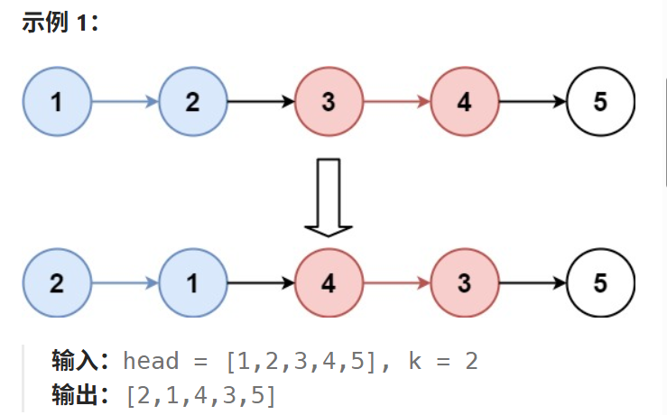
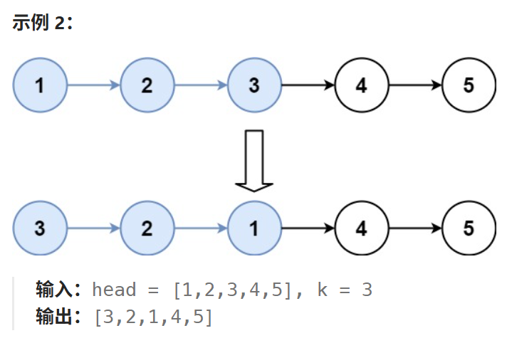

# 25. K 个一组翻转链表

## 25. K 个一组翻转链表

[力扣题目链接](https://leetcode.cn/problems/reverse-nodes-in-k-group/)

给你链表的头节点 `head` ，每 `k` 个节点一组进行翻转，请你返回修改后的链表。

`k` 是一个正整数，它的值小于或等于链表的长度。如果节点总数不是 `k` 的整数倍，那么请将最后剩余的节点保持原有顺序。

你不能只是单纯的改变节点内部的值，而是需要实际进行节点交换。





## 算法思路

实际上我们只需要额外实现一个链表反转的函数 传入头节点和尾节点 对该子节点进行翻转即可 注意小链表翻转无需虚拟节点 结束条件也并非遍历到`null` 而是遍历到原尾节点的`next`

对于大链表 我们依次找K个数字组成的子链表头和尾 传入反转函数后将新的子链表插入原链表即可

大模拟 无算法思想 需要熟练操作链表元素

### 实现

```java
class Solution {
    /**
     * 第一性原理推导：
     * 1. 链表节点只有 next 指针，因此“反转一段链表”的本质就是让该段内每个节点的 next 指向它的前一个节点。
     * 2. 分组处理时，把每组看成独立的子链表，需要保存四个关键位置：
     *      pre  -> 当前组的前驱节点
     *      head -> 当前组原来的头节点
     *      tail -> 当前组原来的尾节点
     *      nex  -> 当前组的后继节点
     * 3. 翻转后重新连接：pre 接新头，新尾接 nex。
     */
    public ListNode reverseKGroup(ListNode head, int k) {
        // 虚拟头节点 因为链表翻转后需要接入原链表 这里引入虚拟节点方便接入
        ListNode hair = new ListNode(0, head);
        // pre 始终表示“当前待翻转组的前驱节点”。
        ListNode pre = hair;
        // 初始化tail
        ListNode tail = hair;

        // 出口1：链表长度是K的整数倍
        while (head != null) {
            // 遍历找尾
            for (int i = 0; i < k ; i++) {
                tail = tail.next;
                // 出口2：链表长度非K的整数倍
                if (tail == null) {
                    return hair.next;
                }
            }
            // 保存当前组后面的第一个节点，因为翻转后当前组的新尾要接回它。
            ListNode nex = tail.next;

            // 翻转 [head, tail] 这一段。
            // 返回数组：第一个是翻转后的新头，第二个是翻转后的新尾。
            ListNode[] tmp = myReverse(head, tail);

            // 接回原链表
            pre.next = tmp[0];
            tmp[1].next = nex;

            // 下个循环起始
            pre = tmp[1];
            head = nex;
            // 注意tail指针指向的地址此时已经被移动到了反转后的链表首部
            // 我们需要手动再把tail的地址拉回来 进行初始化
            tail =  pre;
        }
        return hair.next;
    }

    /**
     * 翻转 [head, tail] 这一段链表。
     *
     * 第一性原理：
     * 反转链表段就是让每个节点的 next 指向前一个节点。
     * 当前段的“前一个节点”初始化为 tail.next，也就是段后的第一个节点。
     * 这样原 head 最终会指向 tail.next，自然与后续链表保持连接。
     */
    // 注意这里cur最后的结束条件不再是全等于null,不同于整个链表的翻转
    // 另外,翻转链表无需头节点
    public ListNode[] myReverse(ListNode head, ListNode tail) {
        ListNode end = tail.next;
        ListNode pre = null;
        ListNode cur = head;
        ListNode tmp = null;
        while (cur != end) {
            tmp = cur.next;
            cur.next = pre;
            pre = cur;
            cur = tmp;
        }
        return new ListNode[]{pre, head};
    }
}

```

