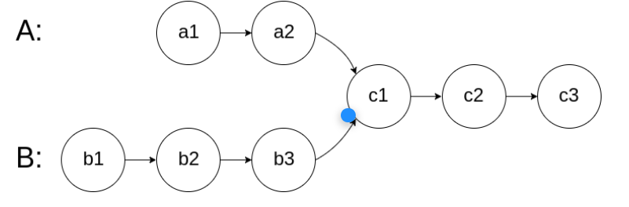
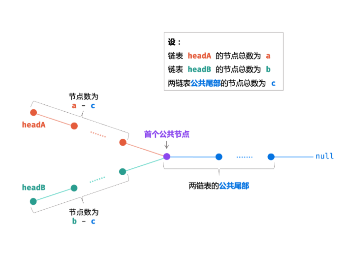

# 面试题 02.07. 链表相交

## 面试题 02.07. 链表相交

[力扣题目链接](https://leetcode.cn/problems/intersection-of-two-linked-lists-lcci/description/)

给你两个单链表的头节点 `headA` 和 `headB` ，请你找出并返回两个单链表相交的起始节点。如果两个链表没有交点，返回 `null` 。

图示两个链表在节点 `c1` 开始相交**：**



题目数据 **保证** 整个链式结构中不存在环。

**注意**，函数返回结果后，链表必须 **保持其原始结构** 。

## 算法思路



如上图所示 我们让指针A从A链表开始遍历 遍历完去遍历B链表 让指针B从B链表开始遍历 遍历完去遍历A链表 当两个指针重合时 此时A走过的长度为
$$
A = a + ( b - c)
$$
此时 B 走过的长度为
$$
B = b + (a - c)
$$
可以看到重合时走的路径一样 但有两种情况 

1. 若两链表 有 公共尾部 (即 c>0 ) ：指针 A , B 同时指向「第一个公共节点」node 。
2. 若两链表 无 公共尾部 (即 c=0 ) ：指针 A , B 同时指向 null 。

因此返回 `A` 即可。

### 实现

```java
public class Solution {
    public ListNode getIntersectionNode(ListNode headA, ListNode headB) {
        ListNode A=headA,B=headB;
        while(A!=B){
            A= A!=null ? A.next : headB;
            B= B!=null ? B.next : headA;
        }
        return A;
    }
}
```
