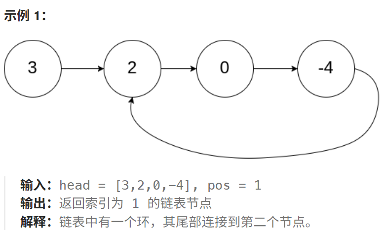
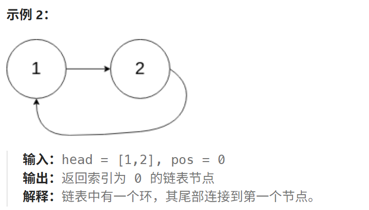
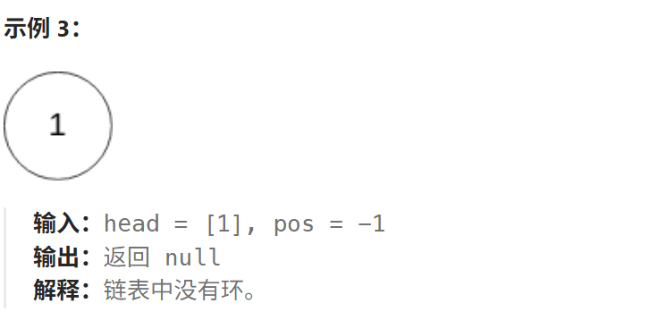
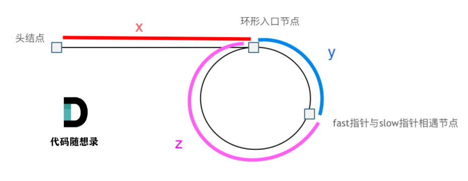

# 142.环形链表II

## 142.环形链表II

[力扣题目链接](https://leetcode.cn/problems/linked-list-cycle-ii/description/)

给定一个链表的头节点  `head` ，返回链表开始入环的第一个节点。 *如果链表无环，则返回 `null`。*

如果链表中有某个节点，可以通过连续跟踪 `next` 指针再次到达，则链表中存在环。 为了表示给定链表中的环，评测系统内部使用整数 `pos` 来表示链表尾连接到链表中的位置（**索引从 0 开始**）。如果 `pos` 是 `-1`，则在该链表中没有环。**注意：`pos` 不作为参数进行传递**，仅仅是为了标识链表的实际情况。

**不允许修改** 链表。







**提示：**

- 链表中节点的数目范围在范围 `[0, 104]` 内
- `-105 <= Node.val <= 105`
- `pos` 的值为 `-1` 或者链表中的一个有效索引

**进阶：**你是否可以使用 `O(1)` 空间解决此题？

## 算法思路

**目标1-判断算法是否有环**：

可以使用快慢指针法，分别定义 fast 和 slow 指针，从头结点出发，fast指针每次移动两个节点，slow指针每次移动一个节点，如果 fast 和 slow指针在途中相遇 ，说明这个链表有环。

为什么fast 走两个节点，slow走一个节点，有环的话，一定会在环内相遇呢，而不是永远的错开呢

首先第一点：**fast指针一定先进入环中，如果fast指针和slow指针相遇的话，一定是在环中相遇，这是毋庸置疑的。**

当slow指针入环的瞬间 fast指针开始追slow指针，相对速度2-1=1，距离为x，则x轮后一定可以追上slow

所以如果相遇了 那一定有环 且不是永远错开

**目标2-找到相遇点：**

假设从头结点到环形入口节点 的节点数为x。 环形入口节点到 fast指针与slow指针相遇节点 节点数为y。 从相遇节点 再到环形入口节点节点数为 z。 如图所示：



根据快指针的速度是慢指针的2倍 存在以下数量关系
$$
2 \times (x + y) = x + y + n \times (y + z)
$$
消去（x+y） 有
$$
x + y = n \times (y + z)
$$
移项
$$
x = n \times (y + z) - y
$$
变形
$$
x = (n - 1) \times (y + z) + y + z - y = (n - 1) \times (y + z) + z
$$


显然的，当fast追上slow时，肯定在圈里走了超过一圈，另外，我们可以定义环长为c，就有
$$
x = z + k \times c,k \geq 0
$$
因此，当一个指针从头节点出发，另一个指针从相遇点出发，他们相遇时的位置即为环的入口，不过，此时相遇点出发的指针可能已经在环里绕了k圈。不过不改变**相遇即入口**的事实！

> 有趣的是 头指针距离入环口的距离一定大于或等于相遇点距离入环口的距离
>
> 极限情况 头指针距离入环口点为0时 相遇点距离入环口也为0 环长为c 慢指针走1圈 快指针走2圈
>
> 拓展可以想到：
>
> 1. 当x<c时，情况如下：
>
> 当头指针距离入环口点为x时 入环时快指针已经在环里距离入环点位置为x处了 
>
> 入环时快指针距离慢指针的相对距离为c-x 只需要c-x轮 快指针就可以追上慢指针
>
> 此时慢指针在环中从入环点走了c - x 步  该点继续走距离入环点的距离刚好为x
>
> 2. 当x>c时，情况如下：
>
> 逆向思维考虑， 当慢指针入环时，快指针还差c-x'的距离追上慢指针
>
> 这个x'的值显然小于c，此时让时间倒转，慢指针距离入环口点为x‘时 快指针在环中也是距离入环口x'
>
> 慢指针入环时快指针已经在环里离开入环点位置为x’处了 
>
> 又回到了1中的情况 只是此时快指针的起点在环中距离入环点距离为x'
>
> 至于慢指针剩下的x-x'段距离 刚好是快指针在环内多走的k圈路程 相当于原地等待了

### 实现

```java
public class Solution {
    public ListNode detectCycle(ListNode head) {
        ListNode fast = head;
        ListNode slow = head;
        while (fast != null && fast.next != null) {
            fast = fast.next.next;
            slow = slow.next;
            if (fast == slow) { // 有环
                slow = head; // 慢指针回到头节点
                while (slow != fast) { // 开始同时移动到入环点
                    slow = slow.next;
                    fast = fast.next;
                }
                return slow;
            }
        }
        return null;
    }
}

```
