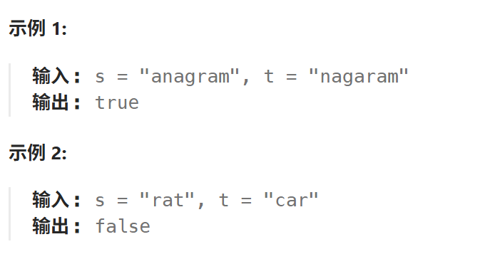

# 242.有效的字母异位词

## 242.有效的字母异位词

[力扣题目链接](https://leetcode.cn/problems/valid-anagram/description/)

给定两个字符串 `s` 和 `t` ，编写一个函数来判断 `t` 是否是 `s` 的 字母异位词。

> 字母异位词是通过重新排列不同单词或短语的字母而形成的单词或短语，并使用所有原字母一次。



**提示:**

- `1 <= s.length, t.length <= 5 * 104`
- `s` 和 `t` 仅包含小写字母

**进阶:** 如果输入字符串包含 unicode 字符怎么办？你能否调整你的解法来应对这种情况？

## 算法思路

固定字符数可以开个26大小的数组实现哈希表计数

非固定就开个`HashMap`计数即可

哈希表处另附写法2，但由于JIT优化只是看起来好了，实际速度不如写法1，数组采用类似写法同理，速度下降了反而

## 实现

仅英文字符，数组

```java
class Solution {
    public boolean isAnagram(String s, String t) {
        if (s.length() != t.length()) return false;
        int []cnt = new int[26];
        for (char c : s.toCharArray()) {
            cnt[c - 'a']++;
        }
        for (char c : t.toCharArray()) {
            cnt[c - 'a']--;
        }
        for (int i : cnt) {
            if (i != 0) return false;
        }
        return true;
    }
}
```

非仅英文字符，哈希表

```java
class Solution {
    public boolean isAnagram(String s, String t) {
        if (s.length() != t.length()) return false;
        Map<Character, Integer> map = new HashMap<Character, Integer>();
        for (char c : s.toCharArray()) {
            map.put(c, map.getOrDefault(c, 0) + 1);
        }
        for (char c : t.toCharArray()) {
            map.put(c, map.getOrDefault(c, 0) - 1);
        }
        for (int i : map.values()) {
            if (i != 0) {
                return false;
            }
        }
        return true;
    }
}
```

写法2

```java
import java.util.HashMap;
import java.util.Map;

//leetcode submit region begin(Prohibit modification and deletion)
class Solution {
    public boolean isAnagram(String s, String t) {
        if (s.length() != t.length()) return false;
        Map<Character, Integer> map = new HashMap<Character, Integer>();
        for (char c : s.toCharArray()) {
            map.put(c, map.getOrDefault(c, 0) + 1);
        }
        for (char c : t.toCharArray()) {
            map.put(c, map.getOrDefault(c, 0) - 1);
            // 这里判断所有计数大于等于0即可间接得出所有计数为0
            if (map.get(c) < 0) {
                return false;
            }
        }
        // s.length() == n.length() 增加减少抵消
        // 1.因此增加的数等于减少的数,总和为0
        // 2.又因为所有字符的计数全都>=0,
        // 综合1和2,得出所有计数全部为0,因此可以直接true
        return true;
    }
}
```

