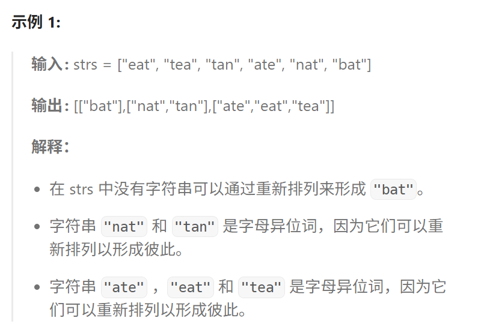
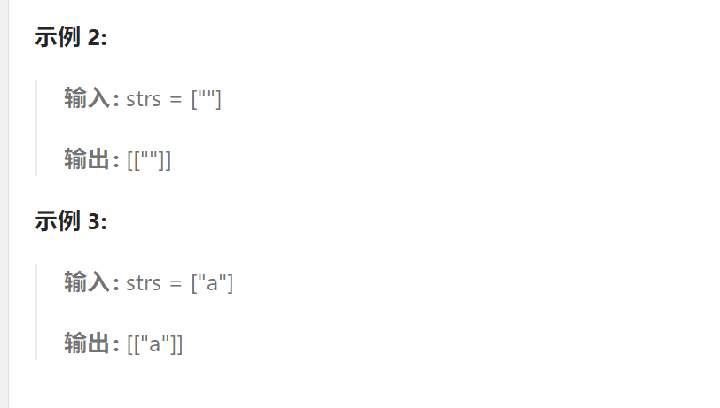

# 49.字母异位词分组

## 49.字母异位词分组

[力扣题目链接](https://leetcode.cn/problems/group-anagrams/description/)

给你一个字符串数组，请你将 字母异位词 组合在一起。可以按任意顺序返回结果列表。





**提示：**

- `1 <= strs.length <= 104`
- `0 <= strs[i].length <= 100`
- `strs[i]` 仅包含小写字母

## 算法思路

开一个哈希表，同一个Key的数据放同一个桶，返回`ArrayList<String>(map.values())`。剩下的问题关键就变成了这个Key如何设计才能更高效？第一种方法是开个小哈希表，统计每个字母出现的次数，用`StringBuild`构建形如`a6b3....`的字母及其出现次数形式作为`key`；另外一种构建`key`的方式为把`str`转化为`char[]`后利用`Arrays.sort()`进行`sort`,然后再转回`String`作为`key`。测试下来直接`sort`甚至更快，可能与编译运行优化有关。

## 实现

`StringBuild`拼接`Key`

```java
class Solution {
    public List<List<String>> groupAnagrams(String[] strs) {
        Map<String, List<String>> map = new HashMap<>();
        // key是排序好的String value是每个组
        for(String str : strs) {
            int []count = new int[26];
            for (char c : str.toCharArray()) {
                count[c - 'a']++;
            }
            StringBuilder sb = new StringBuilder();
            for (int i = 0; i < 26; i++) {
                if (count[i] > 0) {
                    sb.append((char)(i + 'a'));
                    sb.append(count[i]);
                }
            }
            List<String> list = map.getOrDefault(sb.toString(), new ArrayList<>());
            list.add(str);
            map.put(sb.toString(), list);
        }
        return new ArrayList<>(map.values());
    }
}
```

排序后作为`Key`

```java
class Solution {
    public List<List<String>> groupAnagrams(String[] strs) {
        Map<String, List<String>> map = new HashMap<>();
        // key是排序好的String value是每个组
        for(String str : strs) {
            char[] chars = str.toCharArray();
            Arrays.sort(chars);
            String key = new String(chars);
            List<String> list = map.getOrDefault(key, new ArrayList<>());
            list.add(str);
            map.put(key, list);
        }
        return new ArrayList<>(map.values());
    }
}
```

