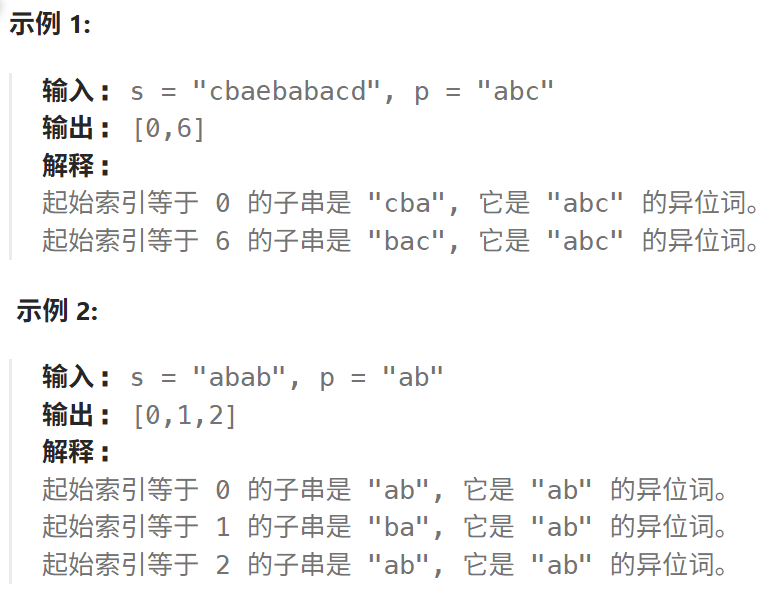

# 438. 找到字符串中所有字母异位词

## 438.找到字符串中所有字母异位词

[力扣题目链接](https://leetcode.cn/problems/find-all-anagrams-in-a-string/)

给定两个字符串 `s` 和 `p`，找到 `s` 中所有 `p` 的 **异位词** 的子串，返回这些子串的起始索引。不考虑答案输出的顺序。

> 找到字符串 `s` 中所有 `p` 的字母异位词子串



**提示：**

- `1 <= strs.length <= 104`
- `0 <= strs[i].length <= 100`
- `strs[i]` 仅包含小写字母

## 算法思路

属于定长滑动窗口，维护一个数组类型的哈希表`need[26]`，表示每个字母还需要多少数量的该字符才能满足条件，设计思想及其类似[76.最小覆盖子串](https://leetcode.cn/problems/minimum-window-substring/)

**这里需要注意的是：**

> 1. `right++;`在一进循环就要执行，`right`代表下一个要加进来的数字
>
> 2. 由1，我们的循环停止条件为`right < m - 1`，也就是`m - 2`处，进去执行`right++`刚好加入最后一个元素
>
> 3. `left`的`diff`判断完后，要**立即更新**`need`数组，否则会影响`right`根据`need`数组判断`diff`的正确性 
>
>    后面单独讲解为什么不能统一更新

```java
        while (right < m - 1) {
            // left 出
            // right 入
            right++;
            if (need[s.charAt(left) - 'a'] == 0) {
                diff++;
            }
            if (need[s.charAt(left) - 'a'] == -1) {
                diff--;
            }
            // 注意这里要提前更新 不能放后面统一更新
            need[s.charAt(left) - 'a']++;
            if (need[s.charAt(right) - 'a'] == 0) {
                diff++;
            }
            if (need[s.charAt(right) - 'a'] == 1) {
                diff--;
            }
            need[s.charAt(right) - 'a']--;
            left++;
            if (diff == 0) {
                res.add(left);
            }
        }
        return res;
```

#### 为什么不能“先判断 left 和 right，再统一更新 need”？

看一个具体例子：

- `p = "a"`，`need['a'] = 1`，`diff = 1`。
- `s = "aa"`。
- 初始窗口 `[0,0]`：加入 `s[0]='a'` 后，`need['a']` 变成 `0`，`diff` 变成 `0`，匹配。
- 现在要滑动到 `[1,1]`：`left = 0`，`right = 0`，新加入的是 `s[1]='a'`。

**正确的顺序：先移出 left，再移入 right。**

1. 移出 `s[0]='a'`：
   - `need['a']` 从 `0` 变成 `1`。
   - 根据规则：`need` 从 `0` 变 `1`，`diff++`，所以 `diff` 从 `0` 变成 `1`。
2. 移入 `s[1]='a'`：
   - `need['a']` 从 `1` 变成 `0`。
   - 根据规则：`need` 从 `1` 变 `0`，`diff--`，所以 `diff` 从 `1` 变成 `0`。
3. 最终 `diff = 0`，窗口 `[1,1]` 匹配。

**如果先判断 left 和 right，再统一更新 need：**

1. 判断 left：`need['a'] == 0`，所以 `diff++`（`diff` 变成 `1`）。
2. 判断 right：此时 `need['a']` 还没有更新，仍然是 `0`，所以又判断 `need['a'] == 0`，再次 `diff++`（`diff` 变成 `2`）。
3. 然后统一执行 `need[left]++` 和 `need[right]--`，最终 `need['a']` 还是 `0`。
4. 但 `diff` 已经变成 `2`，完全错了。

**根本原因**：`left` 和 `right` 指向同一个字符，对 `need` 的影响是相反的。如果先把两个判断都做了，判断 `right` 时用的 `need` 是**没有反映 left 移出影响**的旧值，导致 `diff` 被重复计算。

## 实现

```java
class Solution {
    public List<Integer> findAnagrams(String s, String p) {
        int m = s.length(), n = p.length();
        if (m == 0 || n == 0 || m < n) return new ArrayList<Integer>();
        List<Integer> res = new ArrayList<>();
        int []need = new int[26];
        int diff = 0;
        for (int i = 0; i < n; i++) {
            need[p.charAt(i) - 'a']++;
        }
        for (int i = 0; i < 26; i++) {
            if (need[i] > 0) {
                diff++;
            }
        }
        // 先把右指针移动到p的长度初始化更新need和diff 此后双指针同时移动更新need和diff即可
        int left = 0, right = 0;
        while (right < n) {
            if (need[s.charAt(right) - 'a'] == 1) { // 不成功变成功
                diff--;
            }
            if (need[s.charAt(right) - 'a'] == 0) { // 从成功变为不成功
                diff++;
            }
            need[s.charAt(right) - 'a']--;
            right++;
        }
        // diff == 0 了 放进结果
        if (diff == 0) {
            res.add(left);
        }
        right = n - 1;
        // 同时移动
        while (right < m - 1) {
            // left 出
            // right 入
            right++;
            if (need[s.charAt(left) - 'a'] == 0) {
                diff++;
            }
            if (need[s.charAt(left) - 'a'] == -1) {
                diff--;
            }
            // 注意这里要提前更新 不能放后面统一更新
            need[s.charAt(left) - 'a']++;
            if (need[s.charAt(right) - 'a'] == 0) {
                diff++;
            }
            if (need[s.charAt(right) - 'a'] == 1) {
                diff--;
            }
            need[s.charAt(right) - 'a']--;
            left++;
            if (diff == 0) {
                res.add(left);
            }
        }
        return res;
    }
}
```

