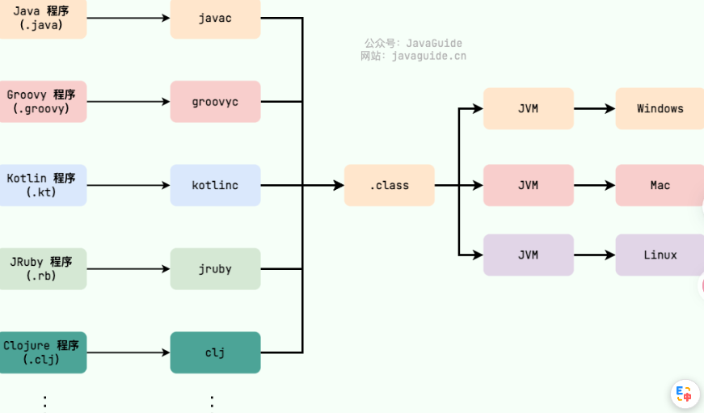
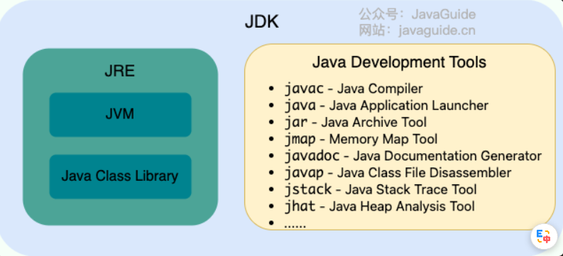
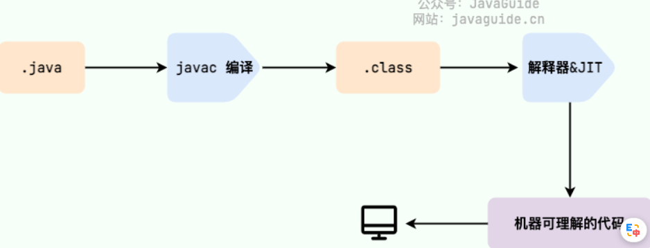
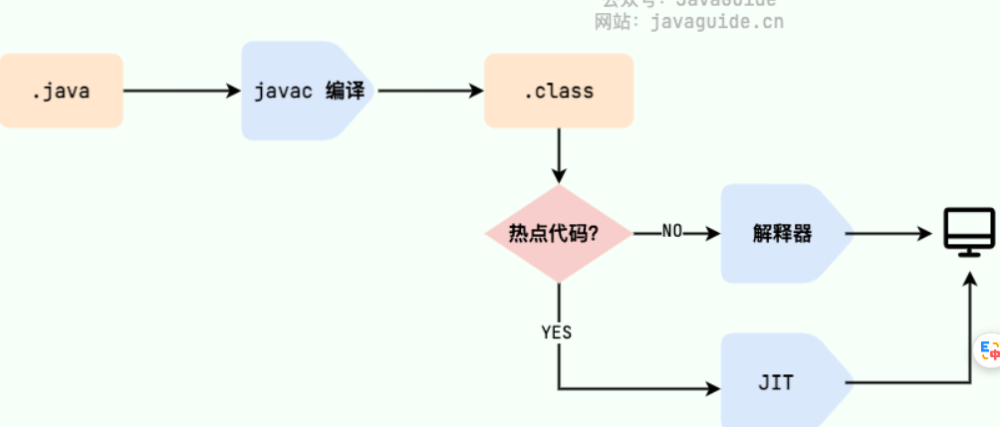
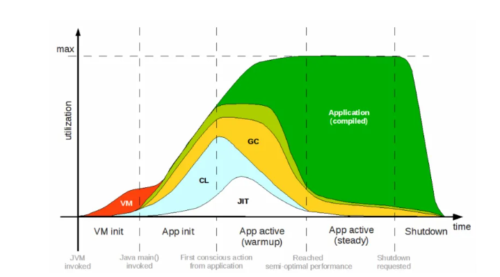
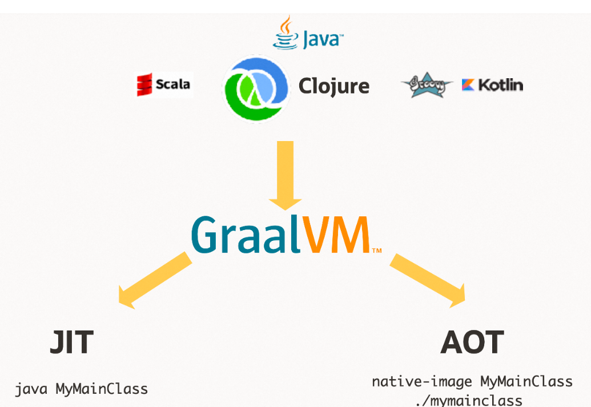
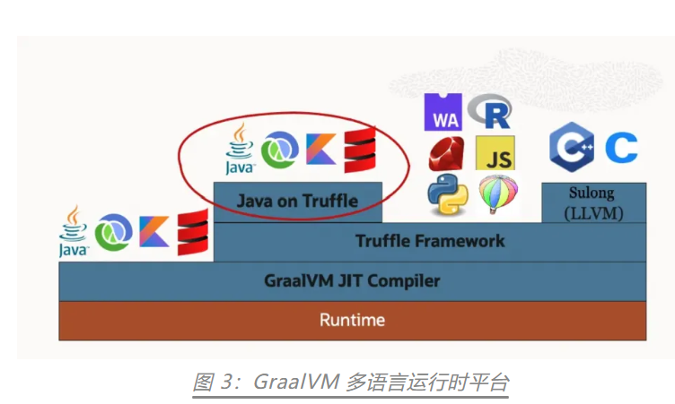
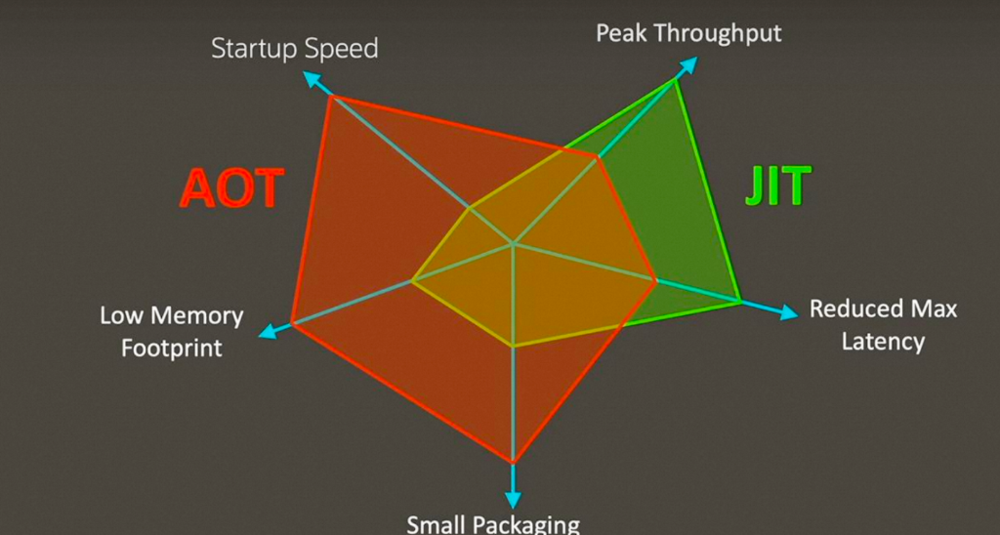
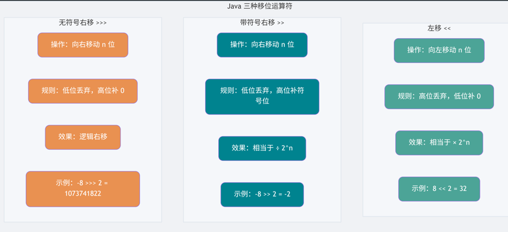

# 基础概念与常识

## 1.JVM、JDK、JRE对比

### JVM

Java 虚拟机（Java Virtual Machine, JVM）是运行 Java 字节码的虚拟机。JVM 有针对不同系统的特定实现（Windows，Linux，macOS），目的是使用相同的字节码，它们都会给出相同的结果。字节码和不同系统的 JVM 实现是 Java 语言“一次编译，随处可以运行”的关键所在。

如下图所示，不同编程语言（Java、Groovy、Kotlin、JRuby、Clojure ...）通过各自的编译器编译成 `.class` 文件，并最终通过 JVM 在不同平台（Windows、Mac、Linux）上运行。



应该留意的是，JVM不止一种，只要满足JVM规范，每个公司或个人都可以开发自己专属的JVM。除了我们平时最常用的 HotSpot VM 外，还有 J9 VM、Zing VM、JRockit VM 等 JVM。

### JDK

JDK（Java Development Kit）是一个功能齐全的 Java 开发工具包，供开发者使用，用于创建和编译 Java 程序。它包含了 JRE（Java Runtime Environment），以及编译器 javac 和其他工具，如 javadoc（文档生成器）、jdb（调试器）、jconsole（监控工具）、javap（反编译工具）等。如下图所示



### JRE

JRE的全称是Java Runtime Environment，即Java运行时环境。JRE 是运行已编译 Java 程序所需的环境，主要包含以下两个部分：

1. **JVM** : 也就是我们上面提到的 Java 虚拟机。
2. **Java 基础类库（Class Library）**：一组标准的类库，提供常用的功能和 API（如 I/O 操作、网络通信、数据结构等）。

### 额外扩展

不过，从 JDK 9 开始，就不需要区分 JDK 和 JRE 的关系了，取而代之的是模块系统（JDK 被重新组织成 94 个模块）+ jlink工具（随 Java 9 一起发布的新命令行工具，用于生成自定义 Java 运行时映像，该映像仅包含给定应用程序所需的模块）。并且，从 JDK 11 开始，Oracle 不再提供单独的 JRE 下载。

在 [Java 9 新特性概览](https://javaguide.cn/java/new-features/java9.html)这篇文章中，我在介绍模块化系统的时候提到：

> 在引入了模块系统之后，JDK 被重新组织成 94 个模块。Java 应用可以通过新增的 jlink 工具，创建出只包含所依赖的 JDK 模块的自定义运行时镜像。这样可以极大的减少 Java 运行时环境的大小。

也就是说，可以用 jlink 根据自己的需求，创建一个更小的 runtime（运行时），而不是不管什么应用，都是同样的 JRE。

> 这里的 **runtime** 是名词，指的就是“运行时环境”（runtime environment）。
>
> 在英语技术语境中，**runtime** 本身已经可以作为一个独立名词，表示“程序运行时所依赖的整套支持系统”，包括库、虚拟机、内存管理等。它并不需要再补充 “environment”，因为词义已经涵盖了“环境”这一概念。

定制的、模块化的 Java 运行时映像有助于简化 Java 应用的部署和节省内存并增强安全性和可维护性。这对于满足现代应用程序架构的需求，如虚拟化、容器化、微服务和云原生开发，是非常重要的。

### 2.什么是字节码？采用字节码的好处是什么？为什么Java解释编译共存？

在 Java 中，JVM 可以理解的代码就叫做字节码（即扩展名为 `.class` 的文件），它不面向任何特定的处理器，只面向虚拟机。好处主要是可以解决传统解释性语言执行效率低的缺点，同时保留解释性语言可以移植的优点。

> 相对解释性语言效率高，是因为不用再运行时现场源代码--->字节码



我们需要格外注意的是 `.class->机器码` 这一步。以 HotSpot 为例，JVM 加载字节码后可以先解释执行，并识别经常调用的方法和代码块（即热点代码），再由 **JIT（Just in Time Compilation）** 编译器将热点字节码编译为机器码。在当前 JVM 进程后续执行这些代码时，可以直接使用已编译的机器码。这也解释了我们为什么经常会说 **Java 是编译与解释共存的语言**。不过，JVM 规范并不要求具体实现必须包含解释器或 JIT 编译器。



这里机器码的具体执行细节是被放到了存放在 JVM 进程的代码缓存（Code Cache）中。当 CPU 执行这段机器码时，**它仍然处于 JVM 进程的上下文之中**。JIT 编译后的机器码 **不需要借助解释器执行**，而是由 CPU 直接执行。但它仍然必须运行在 JVM 进程内，依赖 JVM 的运行时环境（runtime）提供内存管理、对象模型、异常处理等支持。

### 3.AOT是什么？有什么优点？为什么不全部使用AOT?

首先来看下JVM+JIT，这种技术打包出来的应用不能很好的满足Serverless场景的几个关键要求。以下是传统Java程序启动的详细过程图：



- **首先是启动速度问题，Java 冷启动的耗时是比较长的**。这对于Serverless需要快速弹起的场景是一个非常大的挑战，因为 Java 应用的拉起时间可能是秒、数十秒级别的；
- **第二点，Java应用往往都需要一定的预热时间，才能达到最佳的性能状态，因为JIT编译器需要根据热点数据优化**，刚刚拉起的应用如果分配比较大的流量是不合适的，往往会出现请求超时、资源占用过高等问题，这就进一步拉长了 Java 应用的有效拉起时间；
- **第三点是 Java 应用对运行环境的要求，它往往需要较大的内存、计算资源**，而这些真正分配给业务自身的并不多，都消耗在一些JVM运行时上，这与用云降本提效的目标并不匹配；
- **最后，Java应用打出来的包或者镜像也是非常大**，从总体上也影响存储、拉取的效率。

而GraalVM （是一种JDK,和OpenJDK对等）可以为 Java 应用提供除了传统编译方式以外的 AOT 编译和二进制打包能力，基于 GraalVM 打出的二进制包可以实现快速启动、具有超高性能、无需预热时间、同时需要非常少的资源消耗。这里所说的 AOT 是发生在编译期间的一个技术简称， 会在程序执行前将代码编译为机器码，能够减少运行时预热开销并改善启动速度；而Native Image 打包技术这可以将应用打包为可以独立运行的二进制包，这个包是自包含的、可脱离 JVM 运行的应用程序。其作用图如下图所示：



GraalVM Native Image 模式带来的非常大的不同，它在构建本地可执行文件时会进行闭世界分析：构建器从程序入口出发，分析哪些类、方法和字段可能在运行时被访问，只把可达代码和必要的元数据放进最终产物。程序依旧可以接收动态输入和创建对象；构建阶段完全未知的代码则不会自动进入分析结果。



同时应该了解到，GraalVM 实现静态编译能力的编译器就是 GraalVM JIT Compiler。静态编译框架和运行时由 Substrate VM 子项目实现，兼容 OpenJDK 运行时实现，提供了原生镜像程序运行时的异常处理、同步调度、线程管理、内存管理等功能。

另外应该了解到Substrate VM 会将静态编译阶段确定和初始化的内容以及跟 Substrate VM 运行时以及 JDK 库中的数据一起保存到最终可执行文件的 Image Heap 中。其中 Substrate VM 运行时就为最终可执行文件提供了运行过程中所需的垃圾回收、异常处理等能力。对于垃圾回收这块，在一开始的 GraalVM 社区版中仅提供了 Serial GC。企业版中提供了能力更强的 G1 GC。不过在最新的社区版中 GraalVM 团队也引入了 G1 GC以便为广大开发者提供更强大的静态编译使用能力。

> 所以实际上Native Image也有Substrate VM虚拟机，只是没有保留字节码（方法区）、JIT 编译器本身及其工作内存、生成的机器码缓存（Code Cache）、运行时 profiling 数据结构，所以运行时占用内存较小。



GraalVM 不支持反射等动态特性，而我们的很多应用和框架中却大量使用了反射、动态代理等特性，如何才能将这些应用打包为 Native Image 实现静态化那？ GraalVM 提供了元数据配置入口，通过为所有动态特性提供配置文件，“closed world assumption” 模式还是成立的，可以让 GraalVM 在编译期知道所有的预期行为。但实际上也是麻烦的，不利于开发快速进行，因此开发迭代时绝对不会选择这种方式。

由于AOT编译时没有运行时数据，只能做静态分析，很多优化无法进行，长时间运行的峰值性能往往不如 JIT。

所以，AOT 和 JIT 是互补而非替代关系

**AOT 适合**：启动敏感、内存敏感、不可变部署、Serverless、CLI 工具、边缘设备。
**JIT 适合**：长时间运行、性能要求峰值高、动态特性依赖强、需要频繁迭代的复杂业务系统。

### 4.对Java中移位运算符了解多少？举例说明其用法

Java中的主要移位运算符如下：



由于移位运算符的**高效**和**节省内存**，所以其应用还是很广泛的，例如`HashMap`（JDK1.8） 中的 `hash` 方法的源码就用到了移位运算符：

> 1. **高效**：移位运算符直接对应于处理器的移位指令。现代处理器具有专门的硬件指令来执行这些移位操作，这些指令通常在一个时钟周期内完成。相比之下，乘法和除法等算术运算在硬件层面上需要更多的时钟周期来完成。
> 2. **节省内存**：通过移位操作，可以使用一个整数（如 `int` 或 `long`）来存储多个布尔值或标志位，从而节省内存。

```java
static final int hash(Object key) {
    int h;
    // key.hashCode()：返回散列值也就是hashcode
    // ^：按位异或
    // >>>:无符号右移，忽略符号位，空位都以0补齐
    return (key == null) ? 0 : (h = key.hashCode()) ^ (h >>> 16);
  }
```

注意，如果移位的位数超过数值所占有的位数会怎样？

当 int 类型左移/右移位数大于等于 32 位操作时，会先求余（%）后再进行左移/右移操作。也就是说左移/右移 32 位相当于不进行移位操作（32%32=0），左移/右移 42 位相当于左移/右移 10 位（42%32=10）。当 long 类型进行左移/右移操作时，由于 long 对应的二进制是 64 位，因此求余操作的基数也变成了 64。

也就是说：`x<<42` 等同于 `x<<10`，`x>>42` 等同于 `x>>10`，`x >>>42` 等同于 `x >>> 10`。

### 5. 讲讲Java中的基本数据类型和包装类型？

#### 基本类型

Java 中有 8 种基本数据类型，分别为：

- 6 种数字类型：
  - 4 种整数型：`byte(8)`、`short(16)`、`int(32)`、`long(64)`
  - 2 种浮点型：`float(32)`、`double(64)`
- 1 种字符类型：`char(16)`
- 1 种布尔型：`boolean(未定义)`。

**注意：**

1. 整数字面量默认按 `int` 解析；超出 `int` 范围或需要显式写成 `long` 字面量时，应在数值后加 **L**。能通过赋值转换表示的 `int` 字面量可以直接赋给 `long`，例如 `long n = 1;`。
2. 带小数点或指数的浮点字面量默认是 `double`，赋给 `float` 时通常需要加 **f 或 F**；整数字面量在可转换时可直接赋给 `float`，例如 `float n = 1;`。
3. `char a = 'h'`char :单引号，`String a = "hello"` :双引号。

这八种基本类型都有对应的包装类分别为：`Byte`、`Short`、`Integer`、`Long`、`Float`、`Double`、`Character`、`Boolean`。

#### 包装类型

包装类型相当于使用类来包装了基本数据类型。这样做的目的主要是：

1. **让基本类型也能作为对象使用**，比如存入集合（`ArrayList`、`HashMap` 等只能存储对象，不能直接存基本类型）。
2. **提供一些实用的方法**，如类型转换（`Integer.parseInt()`）、比较、进制转换等。
3. **支持 null 值**，在某些场景下可以表示“无值”或“未初始化”。
4. **参与泛型**，因为泛型要求类型参数必须是引用类型。

不过这样也带来一些区别与基本数据类型：

1. **存储方式**：基本数据类型的局部变量保存在当前栈帧的局部变量表中，基本数据类型的实例字段属于对象状态。包装类型属于对象类型，其实例通常分配在堆中，但 JIT 可能通过逃逸分析和标量替换消除实际分配。
2. **占用空间**：相比于包装类型（对象类型）， 基本数据类型占用的空间往往非常小。
3. **默认值**：成员变量包装类型不赋值就是 `null`，而基本类型有默认值且不是 `null`。
4. **比较方式**：对于基本数据类型来说，`==` 比较的是值。对于包装数据类型来说，`==` 比较两个引用是否指向同一个对象（或都为 `null`）。比较包装对象表示的数值通常使用 `equals()` 或相应的 `compare()`/`compareTo()` 方法。

### 6.讲讲包装数据类型的缓存机制？

包装数据类型还有一些需要额外注意的特性，例如**包装类型的缓存机制**

Java 基本数据类型的包装类型的大部分都用到了缓存机制来提升性能。

`Byte`,`Short`,`Integer`,`Long` 这 4 种包装类默认创建了数值 **[-128，127]** 的相应类型的缓存数据，`Character` 创建了数值在 **[0,127]** 范围的缓存数据，`Boolean` 直接返回 `TRUE` or `FALSE`。

对于 `Integer`，可以通过 JVM 参数 `-XX:AutoBoxCacheMax=<size>` 修改缓存上限，但不能修改下限 -128。实际使用时，并不建议设置过大的值，避免浪费内存，甚至是 OOM。

对于 `Byte`,`Short`,`Long` ,`Character` 没有类似 `-XX:AutoBoxCacheMax` 参数可以修改，因此缓存范围是固定的，无法通过 JVM 参数调整。`Boolean` 则直接返回预定义的 `TRUE` 和 `FALSE` 实例，没有缓存范围的概念。

### 7.讲讲包装数据类型与基本数据类型之间的装箱拆箱

### 8.讲讲 `==` 与 `equals()` 的区别