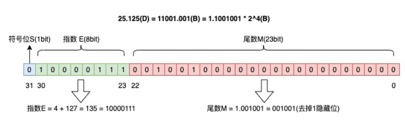
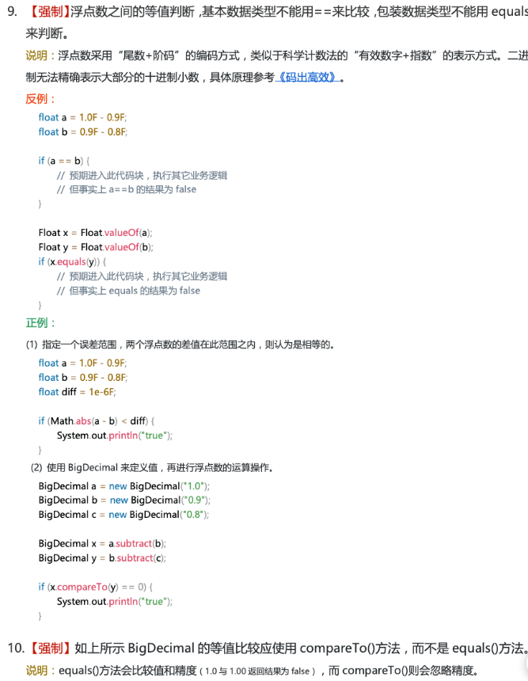
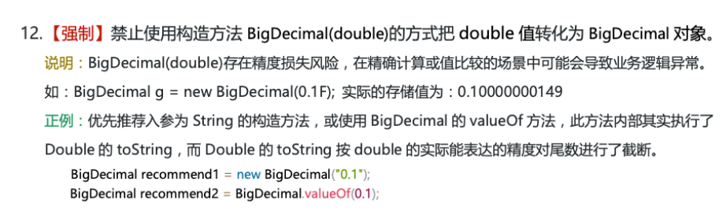
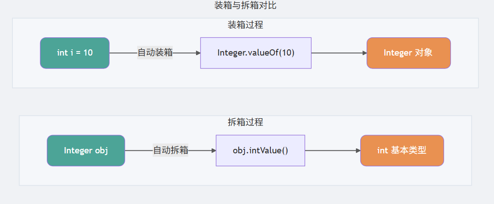
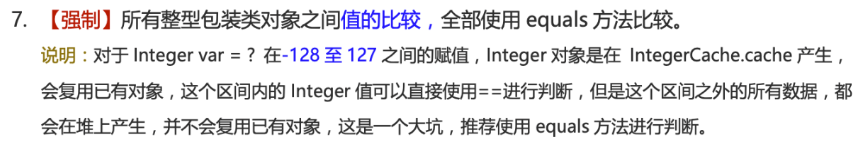

### 1.对Java中移位运算符了解多少？举例说明其用法

Java中的主要移位运算符如下：


由于移位运算符的**高效**和**节省内存**，所以其应用还是很广泛的，例如`HashMap`（JDK1.8） 中的 `hash` 方法的源码就用到了移位运算符：

> 1. **高效**：移位运算符直接对应于处理器的移位指令。现代处理器具有专门的硬件指令来执行这些移位操作，这些指令通常在一个时钟周期内完成。相比之下，乘法和除法等算术运算在硬件层面上需要更多的时钟周期来完成。
> 2. **节省内存**：通过移位操作，可以使用一个整数（如 `int` 或 `long`）来存储多个布尔值或标志位，从而节省内存。

```java
static final int hash(Object key) {
    int h;
    // key.hashCode()：返回散列值也就是hashcode
    // ^：按位异或
    // >>>:无符号右移，忽略符号位，空位都以0补齐
    return (key == null) ? 0 : (h = key.hashCode()) ^ (h >>> 16);
  }
```

注意，如果移位的位数超过数值所占有的位数会怎样？

当 int 类型左移/右移位数大于等于 32 位操作时，会先求余（%）后再进行左移/右移操作。也就是说左移/右移 32 位相当于不进行移位操作（32%32=0），左移/右移 42 位相当于左移/右移 10 位（42%32=10）。当 long 类型进行左移/右移操作时，由于 long 对应的二进制是 64 位，因此求余操作的基数也变成了 64。

也就是说：`x<<42` 等同于 `x<<10`，`x>>42` 等同于 `x>>10`，`x >>>42` 等同于 `x >>> 10`。

### 2. 讲讲Java中的基本数据类型和包装类型？

#### 基本类型

Java 中有 8 种基本数据类型，分别为：

- 6 种数字类型：
  - 4 种整数型：`byte(8)`、`short(16)`、`int(32)`、`long(64)`
  - 2 种浮点型：`float(32)`、`double(64)`
- 1 种字符类型：`char(16)`
- 1 种布尔型：`boolean(未定义)`。

**注意：**

1. 整数字面量默认按 `int` 解析；超出 `int` 范围或需要显式写成 `long` 字面量时，应在数值后加 **L**。能通过赋值转换表示的 `int` 字面量可以直接赋给 `long`，例如 `long n = 1;`。
2. 带小数点或指数的浮点字面量默认是 `double`，赋给 `float` 时通常需要加 **f 或 F**；整数字面量在可转换时可直接赋给 `float`，例如 `float n = 1;`。
3. `char a = 'h'`char :单引号，`String a = "hello"` :双引号。

这八种基本类型都有对应的包装类分别为：`Byte`、`Short`、`Integer`、`Long`、`Float`、`Double`、`Character`、`Boolean`。

#### 包装类型

包装类型相当于使用类来包装了基本数据类型。这样做的目的主要是：

1. **让基本类型也能作为对象使用**，比如存入集合（`ArrayList`、`HashMap` 等只能存储对象，不能直接存基本类型）。
2. **提供一些实用的方法**，如类型转换（`Integer.parseInt()`）、比较、进制转换等。
3. **支持 null 值**，在某些场景下可以表示“无值”或“未初始化”。
4. **参与泛型**，因为泛型要求类型参数必须是引用类型。

不过这样也带来一些区别与基本数据类型：

1. **存储方式**：基本数据类型的局部变量保存在当前栈帧的局部变量表中，基本数据类型的实例字段属于对象状态。包装类型属于对象类型，其实例通常分配在堆中，但 JIT 可能通过逃逸分析和标量替换消除实际分配。
2. **占用空间**：相比于包装类型（对象类型）， 基本数据类型占用的空间往往非常小。
3. **默认值**：成员变量包装类型不赋值就是 `null`，而基本类型有默认值且不是 `null`。
4. **比较方式**：对于基本数据类型来说，`==` 比较的是值。对于包装数据类型来说，`==` 比较两个引用是否指向同一个对象（或都为 `null`）。比较包装对象表示的数值通常使用 `equals()` 或相应的 `compare()`/`compareTo()` 方法。

### 3.讲讲浮点类型运算时的精度丢失问题？讲讲解决方案`BigDecimal`？

#### 精度丢失

浮点数运算精度丢失代码演示：

```java
float a = 2.0f - 1.9f;
float b = 1.8f - 1.7f;
System.out.printf("%.9f",a);// 0.100000024
System.out.println(b);// 0.099999905
System.out.println(a == b);// false
```

浮点数在计算机中的表示是根据以下格式进行的

```java
V = (-1)^S * M * R^E
```

> 例如25.125(D) = 11001.001(B) = 1.1001001 * 2^4(B) = (-1)^0 * 1.1001001 * 2^4
>
> S（符号位） = 0；M（尾数） = 1.1001001；R（进制） = 2；E（指数） =4

具体工程上根据**IEEE754 浮点数标准**，工程实现为：



但精度损失是什么来的呢？可以看到首先需要把十进制数转成二进制数，问题就出现在这里：

0.2 转换为二进制数的过程为，不断乘以 2，直到不存在小数为止，在这个计算过程中，得到的整数部分从上到下排列就是二进制的结果。

```java
0.2 * 2 = 0.4 -> 0
0.4 * 2 = 0.8 -> 0
0.8 * 2 = 1.6 -> 1
0.6 * 2 = 1.2 -> 1
0.2 * 2 = 0.4 -> 0（发生循环）
...
```

所以 0.2(D) = 0.00110…(B)。

因为十进制的 0.2 无法精确转换成二进制小数，而计算机在表示一个数字时，宽度是有限的，无限循环的小数存储在计算机时，只能被截断，所以就会导致小数精度发生损失的情况。

#### 解决方案`BigDecimal`

`BigDecimal`在设计上采用十进制，因此尤其适合金钱运算问题，避免了十进制转二进制时的精度丢失问题。其具体设计如下：

```java
value = unscaledValue × 10^(-scale)
```

> 例如小数123.45，就有：
>
> unscaledValue = 12345
> scale = 2
> value = 12345 × 10^(-2) = 123.45

源码如下：

```java
public class BigDecimal extends Number implements Comparable<BigDecimal> {
    private final BigInteger intVal;          // 大整数表示
    private final int scale;                  // 小数点位置
    private transient int precision;          // 有效数字位数
    private transient String stringCache;

    static final long INFLATED = Long.MIN_VALUE;
    private final transient long intCompact;  // 小数值时用 long 紧凑存储
}
```

不过，使用有限精度的 `MathContext`、执行需要舍入的除法，或将结果转换为 `float`、`double` 时，仍可能发生舍入。

《阿里巴巴 Java 开发手册》中提到：**浮点数之间的等值判断，基本数据类型不能用 == 来比较，包装数据类型不能用 equals 来判断，应该指定误差范围，或者使用`BigDecimal`中的`compareTo`进行等值判断**。



在`BigDecimal`中重写的`equals`方法和`compareTo`方法如下：

```java
// equals()方法不仅比较值，而且比较精度
@Override
public boolean equals(Object x) {
    // 1. 类型检查：必须是 BigDecimal 实例
    if (!(x instanceof BigDecimal)) return false;
    BigDecimal xDec = (BigDecimal) x;
    
    // 2. 引用检查：如果是同一个对象，直接返回 true
    if (x == this) return true;
    
    // 3. 精度检查：scale 必须相等（这是关键差异点）
    if (scale != xDec.scale) return false;
    
    // 4. 数值检查：比较底层表示
    long s = this.intCompact;
    long xs = xDec.intCompact;
    if (s != INFLATED) {
        if (xs == INFLATED) xs = compactValFor(xDec.intVal);
        return xs == s;
    } else if (xs != INFLATED) {
        return xs == compactValFor(this.intVal);
    }
    return this.inflated().equals(xDec.inflated());
}

// compareTo()忽略精度，仅比较值
@Override
public int compareTo(BigDecimal val) {
    // 快速路径：如果精度相同且都是紧凑表示，直接比较数值
    if (scale == val.scale) {
        long xs = intCompact;
        long ys = val.intCompact;
        if (xs != INFLATED && ys != INFLATED)
            return xs != ys ? ((xs > ys) ? 1 : -1) : 0;
    }
    
    // 符号检查：符号不同，直接根据符号返回
    int xsign = this.signum();
    int ysign = val.signum();
    if (xsign != ysign) return (xsign > ysign) ? 1 : -1;
    
    // 两者都为零
    if (xsign == 0) return 0;
    
    // 核心：比较数值大小（忽略精度）
    int cmp = compareMagnitude(val);
    return (xsign > 0) ? cmp : -cmp;
}
```

具体的创建与比较代码如下

```java
BigDecimal a = new BigDecimal("1.0"); // 注意初始化时使用字符串初始化
BigDecimal b = new BigDecimal("1.00"); // 注意初始化时使用字符串初始化
BigDecimal c = new BigDecimal("0.8"); // 注意初始化时使用字符串初始化

BigDecimal x = a.subtract(c); // x = a - c
BigDecimal y = b.subtract(c); // y = b - c

System.out.println(x); /* 0.2 */
System.out.println(y); /* 0.20 */
// 比较内容，不是比较值
System.out.println(Objects.equals(x, y)); /* false */
// 比较值相等用相等compareTo，相等返回0
System.out.println(0 == x.compareTo(y)); /* true */
```

应该额外注意的是`BigDecimal`初始化时使用字符串初始化。



实际上`BigDecimal.valueof(val)`等效为`Double.toString(val)`+`new BigDecimal(String)`。先转字符串再转`BigDecimal`。

以下是常用`BigDecimal`工具类分享

```java
import java.math.BigDecimal;
import java.math.RoundingMode;

/**
 * 简化BigDecimal计算的小工具类
 */
public class BigDecimalUtil {

    /**
     * 默认除法运算精度
     */
    private static final int DEF_DIV_SCALE = 10;

    private BigDecimalUtil() {
    }

    /**
     * 使用 BigDecimal 进行加法运算，结果转换为 double 时仍可能发生舍入。
     *
     * @param v1 被加数
     * @param v2 加数
     * @return 两个参数的和
     */
    public static double add(double v1, double v2) {
        BigDecimal b1 = BigDecimal.valueOf(v1);
        BigDecimal b2 = BigDecimal.valueOf(v2);
        return b1.add(b2).doubleValue();
    }

    /**
     * 使用 BigDecimal 进行减法运算，结果转换为 double 时仍可能发生舍入。
     *
     * @param v1 被减数
     * @param v2 减数
     * @return 两个参数的差
     */
    public static double subtract(double v1, double v2) {
        BigDecimal b1 = BigDecimal.valueOf(v1);
        BigDecimal b2 = BigDecimal.valueOf(v2);
        return b1.subtract(b2).doubleValue();
    }

    /**
     * 使用 BigDecimal 进行乘法运算，结果转换为 double 时仍可能发生舍入。
     *
     * @param v1 被乘数
     * @param v2 乘数
     * @return 两个参数的积
     */
    public static double multiply(double v1, double v2) {
        BigDecimal b1 = BigDecimal.valueOf(v1);
        BigDecimal b2 = BigDecimal.valueOf(v2);
        return b1.multiply(b2).doubleValue();
    }

    /**
     * 提供（相对）精确的除法运算，当发生除不尽的情况时，精确到
     * 小数点以后10位，以后的数字四舍六入五成双。
     *
     * @param v1 被除数
     * @param v2 除数
     * @return 两个参数的商
     */
    public static double divide(double v1, double v2) {
        return divide(v1, v2, DEF_DIV_SCALE);
    }

    /**
     * 提供（相对）精确的除法运算。当发生除不尽的情况时，由scale参数指
     * 定精度，以后的数字四舍六入五成双。
     *
     * @param v1    被除数
     * @param v2    除数
     * @param scale 表示表示需要精确到小数点以后几位。
     * @return 两个参数的商
     */
    public static double divide(double v1, double v2, int scale) {
        if (scale < 0) {
            throw new IllegalArgumentException(
                    "The scale must be a positive integer or zero");
        }
        BigDecimal b1 = BigDecimal.valueOf(v1);
        BigDecimal b2 = BigDecimal.valueOf(v2);
        return b1.divide(b2, scale, RoundingMode.HALF_EVEN).doubleValue();
    }

    /**
     * 使用 HALF_EVEN 规则处理指定小数位。
     *
     * @param v     需要四舍六入五成双的数字
     * @param scale 小数点后保留几位
     * @return 四舍六入五成双后的结果
     */
    public static double round(double v, int scale) {
        if (scale < 0) {
            throw new IllegalArgumentException(
                    "The scale must be a positive integer or zero");
        }
        BigDecimal b = BigDecimal.valueOf(v);
        BigDecimal one = new BigDecimal("1");
        return b.divide(one, scale, RoundingMode.HALF_EVEN).doubleValue();
    }

    /**
     * 转换为 Float，超出 float 精度或范围时可能发生舍入或溢出
     *
     * @param v 需要被转换的数字
     * @return 返回转换结果
     */
    public static float convertToFloat(double v) {
        BigDecimal b = BigDecimal.valueOf(v);
        return b.floatValue();
    }

    /**
     * 转换为 Int，不进行舍入；小数部分会被截断，超出范围时会丢失高位
     *
     * @param v 需要被转换的数字
     * @return 返回转换结果
     */
    public static int convertsToInt(double v) {
        BigDecimal b = BigDecimal.valueOf(v);
        return b.intValue();
    }

    /**
     * 转换为 Long，不进行舍入；小数部分会被截断，超出范围时会丢失高位
     *
     * @param v 需要被转换的数字
     * @return 返回转换结果
     */
    public static long convertsToLong(double v) {
        BigDecimal b = BigDecimal.valueOf(v);
        return b.longValue();
    }

    /**
     * 返回两个数中大的一个值
     *
     * @param v1 需要被对比的第一个数
     * @param v2 需要被对比的第二个数
     * @return 返回两个数中大的一个值
     */
    public static double returnMax(double v1, double v2) {
        BigDecimal b1 = BigDecimal.valueOf(v1);
        BigDecimal b2 = BigDecimal.valueOf(v2);
        return b1.max(b2).doubleValue();
    }

    /**
     * 返回两个数中小的一个值
     *
     * @param v1 需要被对比的第一个数
     * @param v2 需要被对比的第二个数
     * @return 返回两个数中小的一个值
     */
    public static double returnMin(double v1, double v2) {
        BigDecimal b1 = BigDecimal.valueOf(v1);
        BigDecimal b2 = BigDecimal.valueOf(v2);
        return b1.min(b2).doubleValue();
    }

    /**
     * 精确对比两个数字
     *
     * @param v1 需要被对比的第一个数
     * @param v2 需要被对比的第二个数
     * @return 如果两个数一样则返回0，如果第一个数比第二个数大则返回1，反之返回-1
     */
    public static int compareTo(double v1, double v2) {
        BigDecimal b1 = BigDecimal.valueOf(v1);
        BigDecimal b2 = BigDecimal.valueOf(v2);
        return b1.compareTo(b2);
    }

}
```

### 4. 超过long整形的数据如何表示？

基本数值类型都有一个表达范围，如果超过这个范围就会有数值溢出的风险。

在 Java 中，64 位 long 整型是最大的整数类型。

```java
long l = Long.MAX_VALUE;
System.out.println(l + 1); // -9223372036854775808
System.out.println(l + 1 == Long.MIN_VALUE); // true
```

`BigInteger` 内部使用 `int[]` 数组来存储任意大小的整形数据。

相对于常规整数类型的运算来说，`BigInteger` 运算的效率会相对较低

### 5.讲讲包装数据类型与基本数据类型之间的装箱拆箱

- **装箱（Boxing）**：将基本类型用它们对应的引用类型包装起来；
- **拆箱（Unboxing）**：将包装类型转换为基本数据类型；

**只要需要把基本类型变成包装类型，就装箱；需要把包装类型变成基本类型，就拆箱。**



实际上有以下的代码等效：

```java
Integer i = 10;  //装箱 Integer i = Integer.valueOf(10);
int n = i;   //拆箱 int n = i.intValue();
```

具体的实现验证我们可以查看对应的字节码，有：

```java
   L1

    LINENUMBER 8 L1

    ALOAD 0

    BIPUSH 10

    INVOKESTATIC java/lang/Integer.valueOf (I)Ljava/lang/Integer;

    PUTFIELD AutoBoxTest.i : Ljava/lang/Integer;

   L2

    LINENUMBER 9 L2

    ALOAD 0

    ALOAD 0

    GETFIELD AutoBoxTest.i : Ljava/lang/Integer;

    INVOKEVIRTUAL java/lang/Integer.intValue ()I

    PUTFIELD AutoBoxTest.n : I

    RETURN
```

可以看到实际上等效于

```java
Integer i = Integer.valueOf(10);
int n = i.intValue();
```

但需要注意：**如果频繁拆装箱的话，也会严重影响系统的性能。我们应该尽量避免不必要的拆装箱操作。**

另外有：

> 只要需要把基本类型变成包装类型，就装箱；需要把包装类型变成基本类型，就拆箱。

```java
Integer a = 1;
Integer b = 2;
Integer c = 3;
Integer d = 3;
Integer e = 321;
Integer f = 321;
Long g = 3L;

System.out.println(c == d);          // true，缓存内
System.out.println(e == f);          // false，超出缓存
System.out.println(c == (a + b));    // true，a+b 自动拆箱为 int 3，再与 c 比较时 c 也拆箱，数值相等 这里两个类无法相加 拆箱为基本类型
System.out.println(c.equals(a + b)); // true，a+b 结果为 int 3，自动装箱为 Integer 3，equals 比较内容
System.out.println(g == (a + b));    // true，a+b 为 int 3，与 Long 比较时发生类型提升，转为 long 3，数值相等
System.out.println(g.equals(a + b)); // false，a+b 装箱为 Integer，类型不同，equals 返回 false
```

### 6.讲讲包装数据类型的缓存机制？

包装数据类型还有一些需要额外注意的特性，例如**包装类型的缓存机制**

因为小整数在程序中频繁出现（如循环计数器、数组索引等），缓存它们可以显著减少对象创建数量，降低内存占用和 GC 压力。

Java 基本数据类型的包装类型的大部分都用到了缓存机制来提升性能。

`Byte`,`Short`,`Integer`,`Long` 这 4 种包装类默认创建了数值 **[-128，127]** 的相应类型的缓存数据，`Character` 创建了数值在 **[0,127]** 范围的缓存数据，`Boolean` 直接返回 `TRUE` or `FALSE`。

仅浮点型`Float`和`Double`没有实现缓存机制。

对于 `Integer`，可以通过 JVM 参数 `-XX:AutoBoxCacheMax=<size>` 修改缓存上限，但不能修改下限 -128。实际使用时，并不建议设置过大的值，避免浪费内存，甚至是 OOM。

对于 `Byte`,`Short`,`Long` ,`Character` 没有类似 `-XX:AutoBoxCacheMax` 参数可以修改，因此缓存范围是固定的，无法通过 JVM 参数调整。`Boolean` 则直接返回预定义的 `TRUE` 和 `FALSE` 实例，没有缓存范围的概念。

以`Integer`为例，其源码如下：

```java
public static Integer valueOf(int i) {
    if (i >= IntegerCache.low && i <= IntegerCache.high)
        return IntegerCache.cache[i + (-IntegerCache.low)];
    return new Integer(i);
}
private static class IntegerCache {
    static final int low = -128;
    static final int high;
    static {
        // high value may be configured by property
        int h = 127;
    }
}
```

类似的，有`Character`的缓存源码如下：

```java
public static Character valueOf(char c) {
    if (c <= 127) { // must cache
      return CharacterCache.cache[(int)c];
    }
    return new Character(c);
}

private static class CharacterCache {
    private CharacterCache(){}
    static final Character cache[] = new Character[127 + 1];
    static {
        for (int i = 0; i < cache.length; i++)
            cache[i] = new Character((char)i);
    }

}
```

而`Boolean`的缓存源码如下：

```java
public static Boolean valueOf(boolean b) {
    return (b ? TRUE : FALSE);
}
```

根据以上知识，即有：

```java
Integer i1 = 33;
Integer i2 = 33;
System.out.println(i1 == i2);// 输出 true

Float i11 = 333f;
Float i22 = 333f;
System.out.println(i11 == i22);// 输出 false

Double i3 = 1.2;
Double i4 = 1.2;
System.out.println(i3 == i4);// 输出 false
```

第一个是因为都用了`IntegerCache.cache[33 + (-IntegerCache.low)]`处的同一个`Integer`缓存

第二个和第三个是因为浮点类型没有缓存机制。

但应该注意

```java
Integer i1 = 40;
Integer i2 = new Integer(40);
System.out.println(i1==i2); // 输出 false
```

因为`Integer i1=40` 这一行代码会发生装箱，也就是说这行代码等价于 `Integer i1=Integer.valueOf(40)`，这里直接用了缓存池中的对象。但是 `Integer i2 = new Integer(40)` 会直接创建新的对象，没有从缓存池中取，两个对象地址不同，因此`false`。

记住：**所有整型包装类对象之间值的比较，全部使用 equals 方法比较**。



### 7.讲讲字符串常量池？

字符串常量池（String Constant Pool）是 JVM 中一块特殊的内存区域，用于存储**字符串字面量**和**通过 `intern()` 方法主动加入的字符串对象**。它的目的同样是重用字符串对象，避免重复创建内容相同的字符串。

- 在 JDK 7 之前，常量池位于**方法区**（永久代）。
- JDK 7 及之后，常量池被移到了 **Java 堆** 中，以便更好地进行垃圾回收。

字符串常量池用法如下所示：

```java
String s1 = "hello";          // 字面量，直接放入常量池
String s2 = "hello";          // 从常量池中复用已有对象
String s3 = new String("hello"); // 在堆中新建对象，但常量池中已有 "hello"
String s4 = new String("hello"); // 堆中又新建一个对象

System.out.println(s1 == s2);   // true，常量池中同一对象
System.out.println(s1 == s3);   // false，s3 指向堆中新对象
System.out.println(s3 == s4);   // false，两个不同的堆对象
System.out.println(s1.equals(s3)); // true，String 重写了 equals，比较内容
```

另外也可以手动放字符串进常量池，用`intern()` 会检查常量池中是否已有内容相同的字符串：

- 若存在，返回常量池中的引用；
- 若不存在，将该字符串对象的引用放入常量池（JDK 7 及以后，可以直接将堆中对象的引用放入池中），并返回该引用。

```java
String s1 = new String("hello"); // 由于"hello"是字符串对象，自动放入常量池
String s2 = s1.intern();   // 常量池中已有 "hello"，返回池中对象
String s3 = "hello";
System.out.println(s1 == s2); // false，s1 是堆对象，s2 是池对象
System.out.println(s2 == s3); // true，均为池中对象
```

```java
String s1 = new String(new char[]{'h', 'e', 'l', 'l', 'o'});
String s2 = s1.intern();   // 此时常量池中没有 "hello"，s2 会将 s1 的引用放入池中并返回
String s3 = "hello";       // 这个字面量会直接使用池中已有的对象（即 s1 的引用）
System.out.println(s1 == s2); // true（JDK 7+，intern 返回 s1 自身的引用）
System.out.println(s2 == s3); // true
```

另外注意字符串拼接与编译器优化场景下的字符串常量值

```java
String s1 = "hello";
String s2 = "hel" + "lo";   // 字面量，可以编译期优化为 "hello"，从常量池复用
String s3 = "hel";
String s4 = s3 + "lo";      // 运行时拼接，生成新对象，不会自动放入常量池
final String s5 = "hel";
String s6 = s5 + "lo";      // s5 是常量，编译期可确定，优化为 "hello"

System.out.println(s1 == s2); // true
System.out.println(s1 == s4); // false
System.out.println(s1 == s6); // true
```

### 8.讲讲 `==` 与 `equals()` 的区别?

**基本类型数值比较时的自动类型提升**。

```java
42 == 42.0 // true，基本类型比较，int 42 提升为 double 42.0
```

**引用数据类型比较时比较地址**

> 实际上更严谨的说法是：比较引用是否指向同一个对象（或都为 null）、
>
> 以上黑体字是为了便于理解，从实现上说的，本质其实是指向同一对象。

```java
String a = new String("ab"); // 字面量 "ab" 先入常量池；new 在堆中再建一个对象，a 指向堆对象
String b = new String("ab"); // 字面量已在池中；new 在堆中再建另一个对象，b 指向新的堆对象
String aa = "ab";            // 从常量池查找 "ab"，已存在（前面字面量放入），返回池中引用
String bb = "ab";            // 从常量池查找 "ab"，已存在，返回池中同一引用

System.out.println(aa == bb);      // true，aa 与 bb 都指向池中同一对象
System.out.println(a == b);        // false，两个不同的堆对象
System.out.println(a.equals(b));   // true，String 重写 equals，比较内容    
```

### `equals()`方法

继承自`Object`类，默认就是`==`，但我们在自己定义的类中需要对该方法进行重写

```java
public boolean equals(Object obj) {
     return (this == obj);
}
```

例如，`String`类中就对`equals()`方法进行了重写，使得`equals()`方法仅比较属性是否相等，也就是字符串的值是否相等。

```java
// String类重写的equals()方法 仅比较字符串值 不强求是否真的指向同一引用对象
public boolean equals(Object anObject) {
    if (this == anObject) {
        return true;
    }
    if (anObject instanceof String) {
        String anotherString = (String)anObject;
        int n = value.length;
        if (n == anotherString.value.length) {
            char v1[] = value;
            char v2[] = anotherString.value;
            int i = 0;
            while (n-- != 0) {
                if (v1[i] != v2[i])
                    return false;
                i++;
            }
            return true;
        }
    }
    return false;
}
```

### 9.了解`equals()`和`hashcode()`之间必须遵守的契约关系吗？为什么这样设计？

重写`equals()`必须重写`hashcode()`。契约约定：**`equals()`相等的两个对象`hashcode()`必须相等**。也就是：**逻辑相等的两个对象必须映射为同一个哈希桶**

我们首先借助`HashSet`使用`hashcode`的过程了解`hashcode`的具体用法：

当我们把对象加入`HashSet` 时，`HashSet`会先调用对象的 `hashCode()` 方法，得到一个“哈希值”，并通过内部散列函数对这个哈希值再做一次简单的转换（比如取余），决定这条数据应该放进底层数组的哪一个桶（bucket，对应到底层数组的某个位置）：

1. 如果该桶当前是空的，就直接将对象对应的节点插入到这个桶中。
2. 如果该桶中已经有其他元素，HashSet 会在这个桶对应的链表或红黑树中逐个比较：
   - 对于**哈希值不同**的节点，直接跳过；哈希值不同，两个对象一定不相等。
   - 对于**哈希值相同**的节点，则会进一步调用 equals() 方法来检查这两个对象是否“相等”：
     - 如果 `equals()` 返回 true，说明集合中已经存在与当前对象等价的元素，`HashSet` 就不会再次加入它；
     - 如果返回 false， 则认为是新元素，会将该对象作为一个新节点加入到**同一个桶**的链表或红黑树中。这时候产生了哈希碰撞，因此`hashcode`相等的对象不一定逻辑相等。不过一个好的`hashcode`算法能尽量减少哈希碰撞的产生。

通过先利用 `hashCode()` 将候选范围缩小到同一个桶内，再在桶内少量元素上调用 `equals()` 做精确判断，`HashSet` 大大减少了 `equals()` 的调用次数，从而提高了查找和插入的执行效率。

`hashcode()`是`Object`类中提供的方法，其默认实现如下：

```java
static final int hash(Object key) {
    int h;
    // key.hashCode()：返回散列值也就是hashcode
    // ^：按位异或
    // >>>:无符号右移，忽略符号位，空位都以0补齐
    return (key == null) ? 0 : (h = key.hashCode()) ^ (h >>> 16);
  }
```

可以看到实际上是根据引用地址进行的`hashcode()`，但地址不同的两个对象不一定逻辑不同。

例如，一个`Person`对象同时具有`name`和`age`两个属性，我们在`equals`中比较了两个属性，在生成`hashcode`时也要根据这两个属性生成`hashcode`以确保`equals`相等的两个对象`hashcode`相等。

```java
@Override
public int hashCode() {
    return Objects.hash(name, age);
}
```

如果不这样做，在进行哈希操作时，就会出现如下BUG

- `HashSet`中将会出现重复元素,用同样的键找不到元素
- `HashMap`中使用同样的键取不到元素

示例代码如下：
```java
import java.util.*;

class Person {
    String name;
    int age;

    Person(String name, int age) {
        this.name = name;
        this.age = age;
    }

    // 只重写 equals，不重写 hashCode
    @Override
    public boolean equals(Object o) {
        if (this == o) return true;
        if (o == null || getClass() != o.getClass()) return false;
        Person person = (Person) o;
        return age == person.age && Objects.equals(name, person.name);
    }
}

public class EqualsHashCodeDemo {
    public static void main(String[] args) {
        Person p1 = new Person("Alice", 20);
        Person p2 = new Person("Alice", 20);

        System.out.println("p1.equals(p2): " + p1.equals(p2));           // true
        System.out.println("p1.hashCode(): " + p1.hashCode());
        System.out.println("p2.hashCode(): " + p2.hashCode());           // 与 p1 不同
        System.out.println("hashCode 相同? " + (p1.hashCode() == p2.hashCode())); // false

        // 放入 HashSet
        Set<Person> set = new HashSet<>();
        set.add(p1);
        System.out.println("set.contains(p2): " + set.contains(p2));     // false! 逻辑相等却找不到
        System.out.println("set.size(): " + set.size());

        set.add(p2);
        System.out.println("add p2 后 set.size(): " + set.size());       // 2! 出现“重复”元素

        // 放入 HashMap
        Map<Person, String> map = new HashMap<>();
        map.put(p1, "value1");
        System.out.println("map.get(p2): " + map.get(p2));               // null! 用相等的键取不到值
    }
}
```

