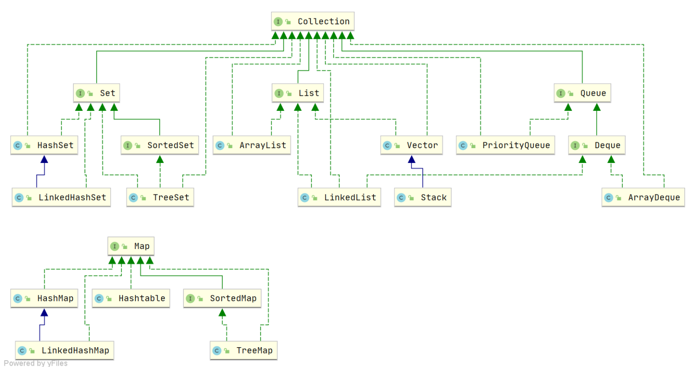

## Java 集合概览

Java 集合，也叫作容器，主要是由两大接口派生而来：一个是 `Collection` 接口，主要用于存放单一元素；另一个是 `Map` 接口，主要用于存放键值对。对于 `Collection` 接口，下面又有三个主要的子接口：`List`、`Set`、 `Queue`。

Java 集合框架如下图所示：

注：图中只列举了主要的继承派生关系，并没有列举所有关系。比方省略了 `AbstractList`, `NavigableSet` 等抽象类以及其他的一些辅助类，如想深入了解，可自行查看源码。

### List