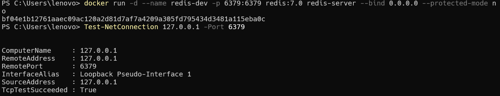
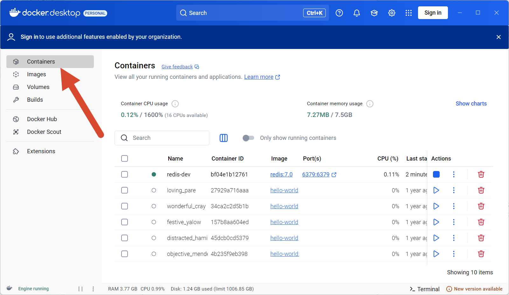
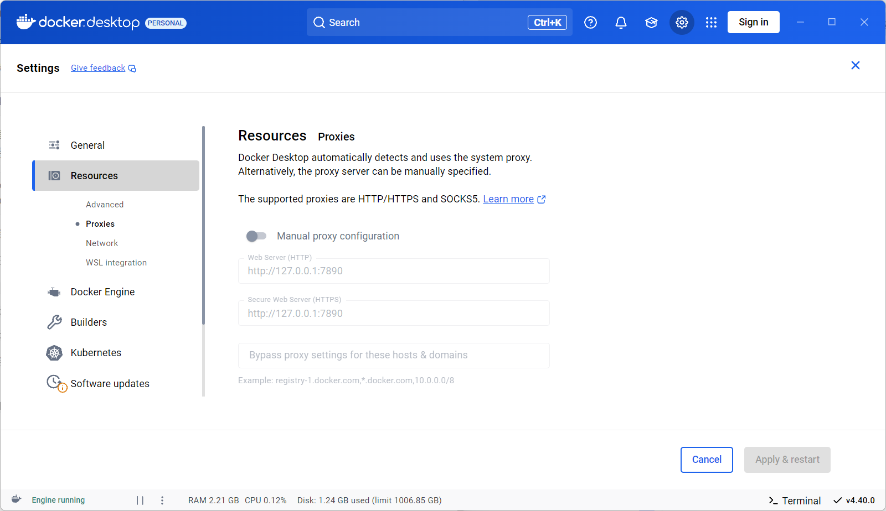
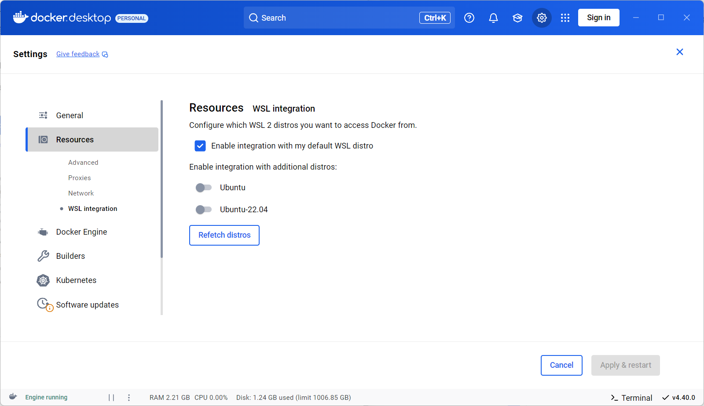
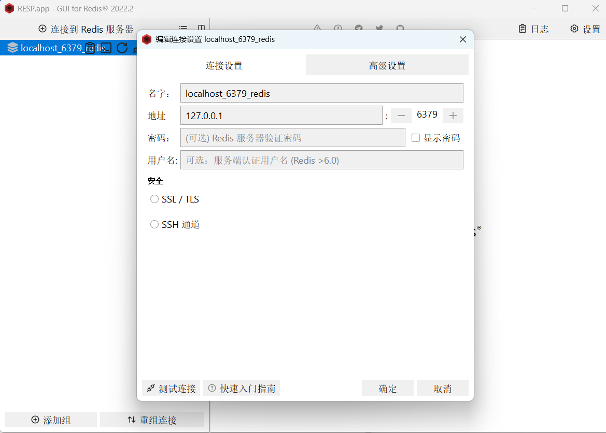

### docker部署redis镜像

在`wsl`中执行

> 在wsl中走默认代理与官方镜像站连接就不会被拒 wsl会自动使用系统代理 也是相当智能了
>
> 需要注意docker对某一个ip的流量会有限流 梯子用的人太多了 很容易pull不下来 因此镜像站加**关梯子**未尝不是好选择
>
> 镜像站拉取：docker pull docker.m.daocloud.io/library/mongo:6
>
> 重命名：docker tag docker.m.daocloud.io/library/mongo:6 mongo:6

```bash
 docker pull redis:7.0  
```

自动走代理从官方站下载镜像 同时通过`Docker Desktop`可以同步镜像情况 之后在本机/wsl中执行以下命令将redis跑起来即可

```bash
docker run -d --name redis-dev -p 6379:6379 redis:7.0 redis-server --bind 0.0.0.0 --protected-mode no
```

> 这条命令的核心目的只有一个：**启动一个对外完全开放、立即可连接的 Redis 服务容器**。
>
> 它通过三层机制实现：
>
> 1. `-p 6379:6379` → 把本机端口“绑”到容器，让外部能碰到 Redis。
> 2. `--bind 0.0.0.0` → 让 Redis 监听所有网卡，不拒绝任何来源的连接。
> 3. `--protected-mode no` → 关闭安全拦截，允许无密码直接访问。
>
> 三者结合，确保容器一跑起来，任何客户端就能用 `本机IP:6379` 连上这个 Redis，无需额外配置。
>
> 注： `-d`代表进程后台执行

完成标志：


后续启动镜像在`Docker Desktop`的`Containers`中启动镜像即可，如下：


附：`Docker Desktop`的一些设置（实际上所有奇怪设置都应该**关掉**，开着只会出拒绝连接的BUG）

> 附赠无魔法镜像站：https://github.com/dongyubin/DockerHub
>
> 使用eg： `docker pull docker.1ms.run/redis`





### 连接到Redis

1.命令行连接

```bash
docker exec -it redis-dev redis-cli
```

2.GUI连接



