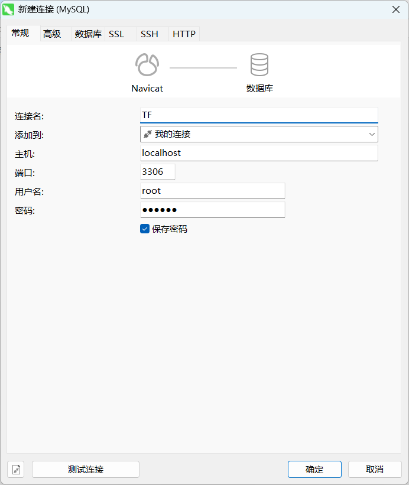

### 执行过程中BUG记录

注意在低版本MySQL的逻辑转储文件转储高版本MySQL时 需要注意高版本MySQL拒绝零日期数据的问题
因 MySQL 8.0 默认启用 `sql_mode` 中的 `NO_ZERO_DATE` 和 `NO_ZERO_IN_DATE`，直接导入包含零日期（`'0000-00-00 00:00:00'`）的 SQL 会报错。例如下面的SQL:

```sql
DROP TABLE IF EXISTS `tb_seckill_voucher`;
CREATE TABLE `tb_seckill_voucher`  (
  `voucher_id` bigint(20) UNSIGNED NOT NULL COMMENT '关联的优惠券的id',
  `stock` int(8) NOT NULL COMMENT '库存',
  `create_time` timestamp NOT NULL DEFAULT CURRENT_TIMESTAMP COMMENT '创建时间',
  `begin_time` timestamp NOT NULL DEFAULT '0000-00-00 00:00:00' COMMENT '生效时间',
  `end_time` timestamp NOT NULL DEFAULT '0000-00-00 00:00:00' COMMENT '失效时间',
  `update_time` timestamp NOT NULL DEFAULT CURRENT_TIMESTAMP ON UPDATE CURRENT_TIMESTAMP COMMENT '更新时间',
  PRIMARY KEY (`voucher_id`) USING BTREE
) ENGINE = InnoDB CHARACTER SET = utf8mb4 COLLATE = utf8mb4_general_ci COMMENT = '秒杀优惠券表，与优惠券是一对一关系' ROW_FORMAT = Compact;
```

在执行中就会被MySQL8.0拒绝，必须改为

```sql
-- Table structure for tb_seckill_voucher
-- ----------------------------
DROP TABLE IF EXISTS `tb_seckill_voucher`;
CREATE TABLE `tb_seckill_voucher`  (
  `voucher_id` bigint UNSIGNED NOT NULL COMMENT '关联的优惠券的id',
  `stock` int NOT NULL COMMENT '库存',
  `create_time` timestamp NOT NULL DEFAULT CURRENT_TIMESTAMP COMMENT '创建时间',
  `begin_time` timestamp NULL DEFAULT NULL COMMENT '生效时间',
  `end_time` timestamp NULL DEFAULT NULL COMMENT '失效时间',
  `update_time` timestamp NOT NULL DEFAULT CURRENT_TIMESTAMP ON UPDATE CURRENT_TIMESTAMP COMMENT '更新时间',
  PRIMARY KEY (`voucher_id`) USING BTREE
) ENGINE = InnoDB CHARACTER SET = utf8mb4 COLLATE = utf8mb4_general_ci COMMENT = '秒杀优惠券表，与优惠券是一对一关系' ROW_FORMAT = COMPACT;
```

默认值为空

### 数据库

文件位置


注意MySql需要8.0及以上的版本，否则会报错，命令行连接MySQL命令如下

> 另外 数据库端口为3306,而不是3360,别连接错了

```bash
mysql -u root -p -P 3306
```

一般采用Navicat连接



运行前面提到的`tfshz.sql`即可


使用Navicat连接后如下


其中涉及的数据库表如下：


