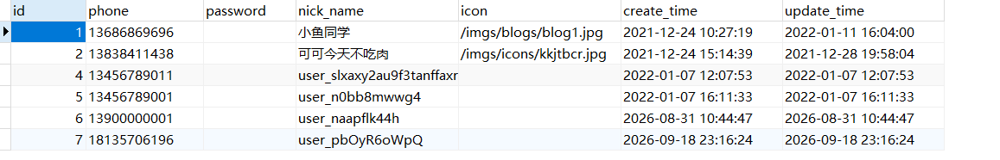

### 数据库映射

我们设计的数据库表如下：

这里以用户表`tb_user`与其在`entify`中的具体实现为例解释



如上图所示，表`tb_user`有七个字段，因此其在`entify`中的对应类`User`有七个属性

```java
package com.tfsh.entity;

import com.baomidou.mybatisplus.annotation.IdType;
import com.baomidou.mybatisplus.annotation.TableId;
import com.baomidou.mybatisplus.annotation.TableName;
import lombok.Data;
import lombok.EqualsAndHashCode;
import lombok.experimental.Accessors;

import java.io.Serial;
import java.io.Serializable;
import java.time.LocalDateTime;

@Data
@EqualsAndHashCode(callSuper = false)
@Accessors(chain = true)
@TableName("tb_user")
public class User implements Serializable {

    @Serial
    private static final long serialVersionUID = 1L;

    /**
     * 主键
     */
    @TableId(value = "id", type = IdType.AUTO)
    private Long id;

    /**
     * 手机号码
     */
    private String phone;

    /**
     * 密码，加密存储
     */
    private String password;

    /**
     * 昵称，默认是随机字符
     */
    private String nickName;

    /**
     * 用户头像
     */
    private String icon = "";

    /**
     * 创建时间
     */
    private LocalDateTime createTime;

    /**
     * 更新时间
     */
    private LocalDateTime updateTime;

}
```

### @Data注解

Lombok 注解。编译时自动生成：

- 所有非静态字段的 `getter`、`setter`
- `toString()`
- `equals()` 和 `hashCode()`
- 一个无参构造器（因为没有 `final`、`@NonNull` 字段时，`@Data` 包含的 `@RequiredArgsConstructor` 会生成无参构造）

### @EqualsAndHashCode注解

```java
@EqualsAndHashCode(callSuper = false)
```

这是 `@Data` 的一部分，但这里显式写出`callSuper = false`，强调：

- `equals` 和 `hashCode` 只考虑**当前类自己的字段**；
- `callSuper = false` 表示不调用父类的 `equals/hashCode`。

这里`User`的父类是`Object`，而`Object`默认的`equals()`实现比较的是两个对象的内存地址，如下：
```java
public boolean equals(Object obj) {
    return this == obj;  // 比较内存地址
}
```

所以，如果没有写出`callSuper = false`，当两个属性相等的不同对象比较时，会调用`Object`中的比较，此时虽然两个对象业务逻辑相等，但比较的结果却是`false`，因此**当父类没有有意义的业务字段时，必须 `callSuper = false`**

不过，`@Data` 本身包含 `@EqualsAndHashCode`，**Lombok 默认 `callSuper = false`**。所以即使不写这一行，效果也一样。但如果父类中有业务字段，就要显示写出`callSuper = true`了

### @Accessors(chain = true)注解

Lombok 注解，让 `setter` 返回 `this`，而不是 `void`。
于是可以链式调用：

```java
User user = new User()
    .setId(1L)
    .setName("张三")
    .setPhone("13800138000");
```

### @TableName("tb_user")注解

MyBatis-Plus 注解，告诉框架：这个 `User` 类对应数据库表 `tb_user`。
如果类名和表名一致，比如 `User` 对应 `user`，可以省略；这里表名是 `tb_user`，所以必须写。

### Serializable可序列化标记接口

`Serializable` 是一个**标记接口**，没有方法。它的作用是告诉 JVM：这个类的对象可以被序列化成字节流，用于：

- 网络传输（RPC、HTTP）
- 缓存（Redis）
- Session 保存
- 文件持久化

### 序列化版本号

```java
@Serial
private static final long serialVersionUID = 1L;
```

- `serialVersionUID`：序列化版本号。反序列化时，JVM 会比对字节流里的版本号和当前类的版本号，一致才允许还原，避免类结构变了还强行反序列化。
- `@Serial`：JDK 14+ 的注解，用来标记“这个成员和序列化有关”，编译器会帮你检查写法是否正确。它**不改变运行行为**，只是编译期校验。如果你的项目是 JDK 8，这个注解不存在，会编译报错。

### 类中属性名与数据库字段名映射

**数据库字段名与Java属性名命名差异**

- 数据库：`user_name`、`create_time`（下划线命名，snake_case）
- Java：`userName`、`createTime`（驼峰命名，camelCase）

在 `application.yml` 中配置:

```yaml
mybatis-plus:
  configuration:
    map-underscore-to-camel-case: true
```

开启后，MyBatis 会自动把查询结果的列名 `user_name` 映射到 Java 属性 `userName`。**MyBatis-Plus 默认就是 `true`**，而原生 MyBatis 默认是 `false`，需要手动开启。

**如果名字完全对不上怎么办？**

用 `@TableField` 显式指定：

```java
@TableField("user_name")
private String name;
```

或者用 `@TableField(exist = false)` 标记“这个字段不是数据库字段”。

### MyBatis-Plus详解

如果没有`MyBatis-Plus`,只能用`jdbc`进行如下的查询操作

```java
Connection conn = DriverManager.getConnection(url, username, password);
String sql = "SELECT id, name, phone FROM tb_user WHERE id = ?";
PreparedStatement ps = conn.prepareStatement(sql);
ps.setLong(1, 1L);
ResultSet rs = ps.executeQuery();

User user = null;
if (rs.next()) {
    user = new User();
    user.setId(rs.getLong("id"));
    user.setName(rs.getString("name"));
    user.setPhone(rs.getString("phone"));
}

rs.close();
ps.close();
conn.close();
```

代码能跑，但是重复性工作太多，很多字段名需要手动映射，Java对象和数据库之间的翻译工作量巨大且重复，于是便诞生了`MyBatis`

你只需要写`Mapper`接口，其具体实现类由`MyBatis`自动生成，你可以写：

```java
@Mapper
public interface UserMapper {
    @Select("select id, name from user where id = #{id}")
    User selectById(Long id);
}
```

或者复杂逻辑单独配置`xml`，如下：

```java
<select id="selectById" resultType="User">
  select id, name from user where id = #{id}
</select>
```

不用自己写实现类，就可以直接在`Service`层调用

```java
User u = userMapper.selectById(1L);
```

而`MyBatis-Plus`更是`MyBatis`的增强版，从以上看，单表的CRUD同样是大量重复性工作，对于每个单表，都写`selectById`、`insert`、`updateById`、`deleteById`，没意义。`MyBatis-Plus`就把这些模式封装成 `BaseMapper`。我们可以直接扩展这个接口就可以直接使用自动生成的实现类了，如下：
```java
@Mapper
public interface UserMapper extends BaseMapper<User> {}
```

就可以直接使用

```java
userMapper.selectById(1L);
userMapper.insert(user);
userMapper.deleteById(1L);
```

对于复杂的条件查询用 Wrapper：

```java
LambdaQueryWrapper<User> q = Wrappers.lambdaQuery(User.class)
    .eq(User::getName, "张三")
    .gt(User::getAge, 18);

List<User> list = userMapper.selectList(q);
```

分页使用

```java
Page<User> page = userMapper.selectPage(new Page<>(1, 10), q);
```

