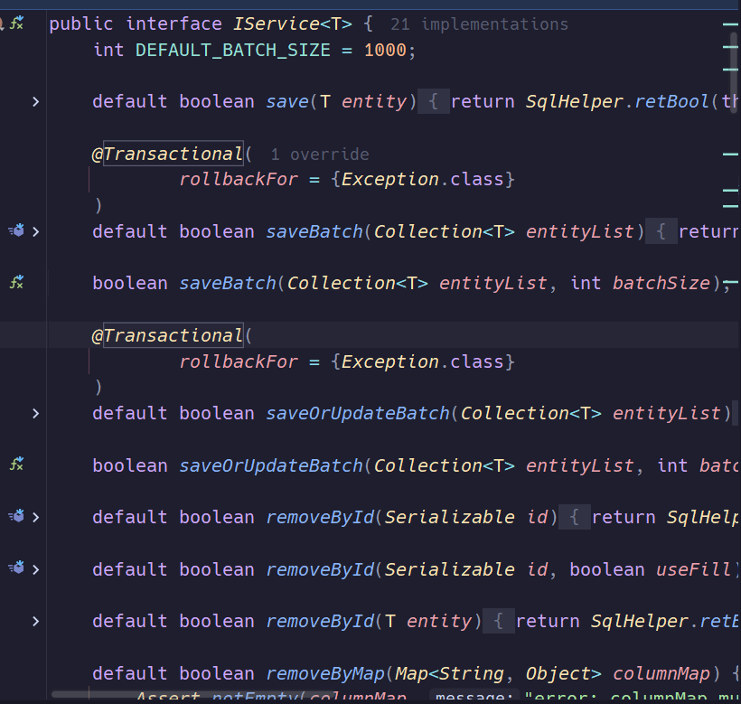

### 整体架构

项目整体采用经典三层架构，`Controller`层接收从前端传来的请求，调用`Service`处理具体业务逻辑，`Service`层调用`Mapper`层操作数据库进行数据读写，并得到处理结果返回给调用它的`Controller`层，`Controller`层根据`Service`返回的结果，将结果封装为`json`文件返回前端。

### 为什么三层？不直接Controller控制Mapper?

Controller 不直接调 Mapper，核心是 **职责分离 + 事务边界 + 可复用 + 可测试**：

1. **事务边界在 Service**：`@Transactional` 应该标在 Service 方法上。Controller 若直接调 Mapper，事务无处安放。
2. **业务可复用**：同一个"发送验证码"逻辑，Web 端、定时任务、MQ 消费者都可能调。放 Service 才能复用。
3. **Controller 很薄**：只做参数校验、调 Service、封装返回，方便换协议（HTTP → RPC → MQ）。
4. **可测试**：Service 不依赖 `HttpServletRequest`，单测容易；Controller 单测要模拟 MVC。
5. **依赖方向**：Controller → Service → Mapper，上层依赖下层抽象，符合依赖倒置。Controller 直接调 Mapper 会让数据访问细节渗透到表现层。

一句话：**分层不是形式，是为了让变化被隔离在各自的层里。**

### Controller层

我们以验证码生成发送给用户手机并保存在后端业务模块为例，首先看`UserController`中的处理流程

```java
@Slf4j
@RestController
@RequestMapping("/user")
public class UserController {

    @Resource
    private IUserService userService;

    @Resource
    private IUserInfoService userInfoService;

    /**
     * 发送手机验证码
     */
    @PostMapping("code")
    public Result sendCode(@RequestParam("phone") String phone, HttpSession session) {
        // 发送短信验证码并保存验证码
        return userService.sendCode(phone, session);
    }
    
    // ....
}

```

我们来逐一解释各个注解

#### `@Slf4j`

它是 Lombok 的注解，编译器自动生成

```java
private static final Logger log = LoggerFactory.getLogger(UserController.class);
```

所以可以直接`log.info(...)`记录日志

#### `@RestController`

它是组合注解，相当于以下两个注解

```java
@Controller
@ResponseBody
```

`@Controller` 表示这个类是一个 Web 控制器；`@ResponseBody` 表示方法返回值直接写进 HTTP 响应体，通常由 `HttpMessageConverter` 转成 JSON。
所以 `sendCode` 返回 `Result` 时，浏览器/前端收到的是 JSON，而不是跳转页面。

我们先讲`@Controller`,这个注解的本质是将该类注册为一个`bean`,这样`RequestMappingHandlerMapping`可以发现这个`bean`并建立`URL -> HandlerMethod`的映射

```java
Spring 容器
   |
   |-- 很多 Bean，其中有 @Controller 的类
   |
RequestMappingHandlerMapping
   |
   |-- 遍历所有 Bean
   |-- 发现 @Controller
   |-- 解析方法上的 @RequestMapping
   |-- 建立映射：URL -> HandlerMethod
```

再来看`@ResponseBody` ，该注解表示方法返回值直接写进 HTTP 响应体，通常由 `HttpMessageConverter` 转成 JSON。直接返回

方法上**没有** `@ResponseBody`，返回值不再直接写响应体，而是交给 `ViewResolver` 处理。

关键看返回值类型：

- 返回 `String`：这个字符串被当作**逻辑视图名**，比如 `return "user/detail"` → 找 `user/detail.html` 或 JSP，渲染后返回 HTML。你说的"渲染后跳转页面"适合这种情况。
- 返回 `Result` 对象（你这里的场景）：它不是视图名，Spring 会把它当模型数据，视图名从请求 URL 推导，通常找不到视图，直接 **500 或 404**，前端拿不到你要的 JSON。

所以准确表述是：**`@Controller` 不带 `@ResponseBody` 时，默认走视图解析；返回值不是 String 视图名时，往往直接报错。** 你这里想返回 JSON，就必须加 `@ResponseBody`，或者用 `@RestController`。

第一性原理：`@ResponseBody` 的本质是告诉 Spring MVC——**别走 ViewResolver，走 `HttpMessageConverter`，把返回值序列化进响应体。** 前端能拿到 JSON，靠的是这个开关，不是 `@RestController` 这个名字本身。

#### `@Resource`

`@Resource` 默认按**字段名/属性名**匹配 Bean 名称；找不到同名 Bean 时，**回退按类型**匹配。所以它不只是"按名称"。

`@Autowired` 默认按类型；有多个同类型候选时，依次按 `@Primary` → `@Qualifier` → 字段名/参数名 来消歧。

`@Resource` 用 `name` 属性指定，`@Autowired` 用 `@Qualifier` 指定。

```java
@Resource(name = "userServiceImpl")
private IUserService userService;

@Autowired
@Qualifier("userServiceImpl")
private IUserService userService;
```

#### `@RequestParam("phone")`

取**查询参数**或**表单参数**。`?phone=181` 是查询参数；`application/x-www-form-urlencoded` 表单里的 `phone` 也能取。不传默认 400，可用 `required=false` 或 `defaultValue` 放开。（意思就是`phone`为必须参数，直接发送`GET /sendCode`服务器端会返回400错误代码**400 Bad Request**）

##### 查询参数

我们先来讲讲**查询参数**

写在 URL 问号后面：

```
GET /sendCode?phone=181
```

这里 `phone=181` 就是查询参数。`@RequestParam("phone")` 能取到它。

一般前端通过`axios`发起查询

以下是`VUE`的写法

```js
this.$axios.get("/sendCode", {
    params: { phone: this.phone }
});
```

最原始的：

```html
<a href="/sendCode?phone=181">发送验证码</a>
```

稍微高级一点：

```html
<form action="/sendCode" method="get">
    <input name="phone" value="181">
    <button type="submit">发送</button>
</form>
```

> 这里`get`自动发`/sendCode?phone=181`
>
> `post`则会放入请求体，但 `@RequestParam` 两种都能取。

不过由于需要异步传输，最常用的还是`axios`

```js
axios.get("/sendCode", {
    params: {
        phone: "181",
        type: "login"
    }
});
```

不过应该注意的是`axios`传输表单时默认使用`json`

```js
axios.post("/sendCode", { phone: "181" });
```

发过去

```html
POST /sendCode
Content-Type: application/json

{"phone":"181"}
```

这时后端必须用：

```java
@PostMapping("/sendCode")
public Result sendCode(@RequestBody PhoneDTO dto) { ... }
```

`@RequestParam("phone")` 取不到。

如果要用 `@RequestParam`，前端要发查询参数或表单：

```js
axios.post("/sendCode", null, {
    params: { phone: "181" }
});
```

或者：

```js
axios.post("/sendCode", new URLSearchParams({ phone: "181" }));
```

##### 表单参数

HTML 表单提交时，浏览器会把表单字段放在请求体里

```html
<form action="/sendCode" method="post">
    <input name="phone" value="181">
    <button type="submit">提交</button>
</form>
```

提交后，请求大概是：

```http
POST /sendCode
Content-Type: application/x-www-form-urlencoded

phone=181
```

此时`@RequestParam("phone")`也可以取到

如果请求体是 JSON：

```http
POST /sendCode
Content-Type: application/json

{"phone":"181"}
```

这时 `@RequestParam("phone")` **取不到**。
JSON 请求体要用 `@RequestBody`：

```java
@PostMapping("/sendCode")
public Result sendCode(@RequestBody PhoneDTO dto) { ... }
```

### Service层

我们先来看`Service`层存在的接口

```java
public interface IUserService extends IService<User> {

    Result sendCode(String phone, HttpSession session);

    Result login(LoginFormDTO loginForm, HttpSession session);

    Result sign();

    Result signCount();

}

// 以下是实现类
@Slf4j
@Service
public class UserServiceImpl extends ServiceImpl<UserMapper, User> implements IUserService {

    @Resource
    private StringRedisTemplate stringRedisTemplate;

    @Override
    public Result sendCode(String phone, HttpSession session) {
        // 1.校验手机号
        if (RegexUtils.isPhoneInvalid(phone)) {
            // 2.如果不符合，返回错误信息
            return Result.fail("手机号格式错误！");
        }
        // 3.符合，生成验证码
        String code = RandomUtil.randomNumbers(6);

        // 4.保存验证码到 session
        stringRedisTemplate.opsForValue().set(LOGIN_CODE_KEY + phone, code, LOGIN_CODE_TTL, TimeUnit.MINUTES);

        // 5.发送验证码
        log.debug("发送短信验证码成功，验证码：{}", code);
        // 返回ok
        return Result.ok();
    }

...
}
```

#### `IService<User>`

`IService<T>` 是 **MyBatis-Plus** 提供的接口（不是 Spring 的，也不是 MyBatis 原生的，是 MyBatis-Plus 在 MyBatis 之上封的一层）。

- `T`：泛型参数，表示**操作的实体类型**。
- `IService<User>`：表示"这个 Service 管理的是 `User` 实体"。



| 类别     | 代表方法                                                     | 作用     |
| -------- | ------------------------------------------------------------ | -------- |
| 增       | `save(T)`、`saveBatch(Collection<T>)`、`saveOrUpdate(T)`     | 插入     |
| 删       | `removeById(id)`、`removeByMap(map)`、`remove(Wrapper)`      | 删除     |
| 改       | `updateById(T)`、`update(T, Wrapper)`、`updateBatchById(...)` | 更新     |
| 查单条   | `getById(id)`、`getOne(Wrapper)`                             | 查一条   |
| 查多条   | `list()`、`list(Wrapper)`、`listByIds(...)`                  | 查多条   |
| 分页     | `page(IPage<T>, Wrapper)`                                    | 分页     |
| 计数     | `count()`、`count(Wrapper)`                                  | 统计     |
| 存在判断 | `exists(Wrapper)`                                            | 是否存在 |

**注意：`IService<T>` 只有 `T` 一个泛型，因为它只关心"操作哪个实体"，不关心底层用哪个 Mapper。** Mapper 由它的实现类决定，往下看。

#### `@Service`

其本质仍然为标识一个类为`bean`,源码如下：

```java
@Target(ElementType.TYPE)
@Component   // 本质就是它
public @interface Service { ... }
```

**`@Service` = `@Component` 的语义特化版。**

| 注解                              | 语义层     | 本质                           |
| --------------------------------- | ---------- | ------------------------------ |
| `@Controller` / `@RestController` | 表现层     | `@Component`                   |
| `@Service`                        | 业务层     | `@Component`                   |
| `@Repository`                     | 数据访问层 | `@Component`（额外做异常转换） |
| `@Component`                      | 通用       | 根注解                         |

功能上基本没有区别。 Spring 扫描时，这四个注解都能把类注册成 Bean，处理逻辑一样（`@Repository` 多一个"把 SQL 异常转成 Spring 的 `DataAccessException`"）。、

拆分主要是为了让人读懂，也就是**可读性 + 分层语义。** 看到 `@Service` 就知道这是业务层，看到 `@Controller` 就知道这是入口。团队协作、代码 review、分层架构约定，全靠这个语义。

```java
@Service
public class UserServiceImpl extends ServiceImpl<UserMapper, User> implements IUserService { ... }
```

- 让 Spring 扫描到它，注册成 Bean。
- Bean 名字默认 = 类名首字母小写 = `userServiceImpl`。
- 之后 `@Resource private IUserService userService;` 才能按类型找到它注入。

**如果没有 `@Service`，容器里没有这个 Bean，Controller 注入直接报 `NoSuchBeanDefinitionException`。**


#### `public class UserServiceImpl extends ServiceImpl<UserMapper, User> implements IUserService`

##### 第 1 段：`extends ServiceImpl<UserMapper, User>`

`ServiceImpl` 是 MyBatis-Plus 提供的**抽象类**，它实现了 `IService`，泛型长这样：

```java
public class ServiceImpl<M extends BaseMapper<T>, T> implements IService<T> {
    @Autowired
    protected M baseMapper;   // 关键字段 拿到扫描mapper时扫出来的代理对象

    @Override
    public boolean save(T entity) {
        return baseMapper.insert(entity) > 0;
    }
    // ... 实现 IService 的所有通用 CRUD
}
```

`UserServiceImpl` 传进去的两个泛型：

| 泛型 | 你的值       | 告诉父类什么                   |
| ---- | ------------ | ------------------------------ |
| `M`  | `UserMapper` | 用哪个 Mapper 去执行 SQL       |
| `T`  | `User`       | 操作哪个实体（表名由实体映射） |

**父类靠 `@Autowired protected M baseMapper;` 拿到 `UserMapper` 的代理对象**，所有 CRUD 都委托给它。

所以继承这一刻，`UserServiceImpl` 白嫖了：

- `this.save(user)` → 底层 `baseMapper.insert(user)`
- `this.getById(1L)` → 底层 `baseMapper.selectById(1L)`
- `this.list()` → 底层 `baseMapper.selectList(null)`
- …… 全套 CRUD

**你一行 CRUD 没写，能力全有了。这就是"继承 + 泛型 + 模板方法"的威力。**

##### 第 2 段：`implements IUserService`

`IUserService` 是**你自己定义的接口**：

```java
public interface IUserService extends IService<User> {
    Result sendCode(String phone, HttpSession session);
    Result login(LoginFormDTO loginForm, HttpSession session);
    Result sign();
    Result signCount();
}
```

注意它 **`extends IService<User>`**——所以它继承了 `IService` 的全部方法签名。

这意味着 `UserServiceImpl` 要实现的接口方法分两部分：

1. **从 `IService<User>` 继承的**：`save`、`getById`、`list`…… → **父类 `ServiceImpl` 已经实现好了**，你不用写。
2. **`IUserService` 自己声明的**：`sendCode`、`login`、`sign`、`signCount` → **你必须自己实现**。

##### 第 3 段：合起来看继承链

```text
IService<T>                                ← 接口：通用 CRUD 契约
    ↑ implements
ServiceImpl<M extends BaseMapper<T>, T>    ← 抽象类：通用 CRUD 实现，持有 baseMapper
    ↑ extends
UserServiceImpl                            ← 你的类：白嫖 CRUD + 实现业务方法
    ↑ implements
IUserService extends IService<User>        ← 你的接口：业务方法 + 继承通用 CRUD
```

一眼看懂：**`ServiceImpl` 负责"通用能力"，`IUserService` 负责"业务契约"，`UserServiceImpl` 把它们缝在一起。**

##### 第 4 段：为什么 Service 也要"接口 + 实现"分开

和 Controller 注入 `IUserService` 而不是 `UserServiceImpl` 是同一个原因：

1. **面向接口编程**：上层依赖抽象，换实现不改调用方。
2. **可加代理**：`@Transactional` 靠代理，有接口更适合 JDK 动态代理。
3. **可测试**：单测时 mock `IUserService` 就行。
4. **语义清晰**：接口说"能做什么"，实现说"怎么做"。

#### Mapper层

源码很简单，如下所示：

```java
public interface UserMapper extends BaseMapper<User> {
}
```

##### 一、为什么没有实现类

Mapper 是接口，不能 `new`。MyBatis 启动时通过 `MapperFactoryBean.getObject()` 调 `Proxy.newProxyInstance()` 生成 **JDK 动态代理**，作为 Bean 放进容器。

容器里从头到尾只有代理，没有真实对象。

##### 二、SQL 从哪来

| 方法                                          | 来源                                |
| --------------------------------------------- | ----------------------------------- |
| `selectById`、`insert`（继承自 `BaseMapper`） | MyBatis-Plus 按泛型 `T = User` 推导 |
| `selectByPhone`（自己声明）                   | `@Select` 注解或 XML                |

两者最终都解析成 `MappedStatement`，存进 `Configuration` 的 Map，key = 全限定方法名。

报 `Invalid bound statement` = 方法有，SQL 没绑定上。 排查：注解 / XML id / mapper-locations 路径。

##### 三、执行链路

```text
userMapper.selectById(1L)
  → MapperProxy.invoke() 拼 statementId
  → Configuration.getMappedStatement()
  → SqlSession → Executor → StatementHandler → JDBC
  → ResultSetHandler 映射成 User
```

##### 四、缓存

- **一级缓存**：SqlSession 级，默认开。Spring 下每次调用新 SqlSession，基本不跨方法生效。
- **二级缓存**：Mapper 级，默认关。跨会话共享，多表易脏读，生产用 Redis 替代。

##### 五、`#{}` vs `${}`

- `#{}`：预编译 `?`，参数不参与 SQL 解析，**防注入，默认用**。
- `${}`：字符串拼接，**有注入风险**，只在动态表名 / 列名 / 排序时用，且必须白名单校验。

##### 六、注意事项

1. 接口要被 `@MapperScan` 或 `@Mapper` 扫到。
2. 自定义方法必须写 SQL，否则 `Invalid bound statement`。
3. `BaseMapper` 泛型别写错。
4. 不在循环里调 Mapper，用 `selectBatchIds` 批量查。
5. 事务边界在 Service，不在 Mapper。

一句话：Mapper = 接口 + 动态代理；SQL 来自泛型推导或注解/XML；`#{}` 安全，`${}` 危险。

### 额外：axios详解

```js
axios.post("/login", new URLSearchParams({ username: "zhangsan" }))
```

同学，你判断得对：

> `axios.post("/login", new URLSearchParams({ username: "zhangsan" }))`  
> 就是发表单参数，后端用 `@RequestParam("username")` 取。

你卡住的只是 `new URLSearchParams(...)` 这个前端 API。我们把它当成一个**表单编码器**就懂了。

---

## 一、`URLSearchParams` 是什么？

它是浏览器内置的一个类，专门用来表示这种格式：

```text
username=zhangsan&password=123
```

这种格式就是：

- URL 查询参数：`?username=zhangsan&password=123`
- 表单提交：`application/x-www-form-urlencoded`

所以 `URLSearchParams` 既可以拼 URL 查询串，也可以当表单请求体。

---

## 二、`new URLSearchParams({ username: "zhangsan" })` 做了什么？

你给它一个普通对象：

```js
{ username: "zhangsan" }
```

它创建一个 `URLSearchParams` 对象，内部记住：

```text
username = zhangsan
```

然后你调用它的 `toString()`：

```js
const params = new URLSearchParams({ username: "zhangsan" });
console.log(params.toString());
```

输出：

```text
username=zhangsan
```

所以它本质上就是：**把对象转成 `key=value` 格式的字符串。**

---

## 三、为什么 axios 看到它，就发成表单？

因为 axios 会判断第二个参数的类型：

### 情况 1：普通对象

```js
axios.post("/login", { username: "zhangsan" });
```

axios 认为你要发 JSON，于是：

```http
POST /login
Content-Type: application/json

{"username":"zhangsan"}
```

后端要用 `@RequestBody`。

### 情况 2：`URLSearchParams`

```js
axios.post("/login", new URLSearchParams({ username: "zhangsan" }));
```

axios 认出来这是表单格式，于是：

```http
POST /login
Content-Type: application/x-www-form-urlencoded;charset=utf-8

username=zhangsan
```

后端就用 `@RequestParam("username")` 取。

所以 `URLSearchParams` 的作用就是：**告诉 axios：别发 JSON，我要发表单。**

---

## 四、它等价于什么？

上面那行代码，大致等价于：

```js
axios.post("/login", "username=zhangsan", {
    headers: {
        "Content-Type": "application/x-www-form-urlencoded"
    }
});
```

或者原生 `fetch`：

```js
fetch("/login", {
    method: "POST",
    body: new URLSearchParams({ username: "zhangsan" })
});
```

浏览器会自动设置：

```http
Content-Type: application/x-www-form-urlencoded;charset=UTF-8
```

请求体：

```text
username=zhangsan
```

---

## 五、为什么要用它，不直接写字符串？

直接写：

```js
axios.post("/login", "username=zhangsan");
```

也能发，但有坑：

1. 多个参数要自己拼 `&`。
2. 特殊字符、中文要自己编码。
3. 容易漏掉 `Content-Type`。

用 `URLSearchParams` 就自动处理：

```js
const params = new URLSearchParams({
    username: "zhangsan",
    password: "123"
});

console.log(params.toString());
// username=zhangsan&password=123
```

中文和特殊字符也会自动编码：

```js
const params = new URLSearchParams({
    keyword: "张三 & 李四"
});

console.log(params.toString());
// keyword=%E5%BC%A0%E4%B8%89+%26+%E6%9D%8E%E5%9B%9B
```

Spring 收到后会自动解码回 `"张三 & 李四"`。

---

## 六、完整对照

### 前端发 JSON

```js
axios.post("/login", { username: "zhangsan" });
```

请求：

```http
POST /login
Content-Type: application/json

{"username":"zhangsan"}
```

后端：

```java
@PostMapping("/login")
public Result login(@RequestBody LoginDTO dto) { ... }
```

### 前端发表单

```js
axios.post("/login", new URLSearchParams({ username: "zhangsan" }));
```

请求：

```http
POST /login
Content-Type: application/x-www-form-urlencoded

username=zhangsan
```

后端：

```java
@PostMapping("/login")
public Result login(@RequestParam("username") String username) { ... }
```

或者：

```java
@PostMapping("/login")
public Result login(UserForm form) { ... }
```

---

## 七、一句话总结

> `new URLSearchParams({ username: "zhangsan" })` 就是一个前端工具，把对象变成 `username=zhangsan` 这种表单格式。axios 收到它，就会以 `application/x-www-form-urlencoded` 发请求。后端 Servlet 容器把它解析成参数表，所以 `@RequestParam("username")` 能取到。

---

## 一、`axios.post` 的参数签名

```js
axios.post(url, data, config)
```

- 第一个参数：`url`
- 第二个参数：`data`，请求体数据
- 第三个参数：`config`，额外配置，比如 `headers`、`params`、`timeout`

所以：

```js
axios.post("/login", "username=zhangsan", {});
```

第三个参数是空对象 `{}`，意思是：**没有任何额外配置**。  
没有设置 `headers`，也没有设置 `Content-Type`。

而之前那个“等价写法”：

```js
axios.post("/login", "username=zhangsan", {
    headers: {
        "Content-Type": "application/x-www-form-urlencoded"
    }
});
```

第三个参数里**明确设置了 `Content-Type`**。  
所以两者当然不等价。

---

## 二、`new URLSearchParams` 为什么能自动设置？

你说得对：

> axios 会判断第二个参数是不是 `URLSearchParams` 对象。

axios 内部大致有这段逻辑：

```js
if (utils.isURLSearchParams(data)) {
    setContentTypeIfUnset(headers, "application/x-www-form-urlencoded;charset=utf-8");
    return data.toString();
}
```

意思是：

1. 如果 `data` 是 `URLSearchParams` 对象；
2. 自动把 `Content-Type` 设成 `application/x-www-form-urlencoded;charset=utf-8`；
3. 把 `data` 转成 `username=zhangsan` 这样的字符串作为请求体。

所以：

```js
axios.post("/login", new URLSearchParams({ username: "zhangsan" }));
```

发出去是：

```http
POST /login
Content-Type: application/x-www-form-urlencoded;charset=utf-8

username=zhangsan
```

后端 `@RequestParam("username")` 能取到。

---

## 三、那直接传字符串为什么不行？

因为：

```js
axios.post("/login", "username=zhangsan", {});
```

第二个参数是**普通字符串**，不是 `URLSearchParams`。  
axios 不会触发上面那个特殊分支，所以不会自动设置 `Content-Type` 为 `application/x-www-form-urlencoded`。

那它会设置成什么？

这取决于 axios 版本和运行环境。常见情况：

- 如果 axios 没有设置 `Content-Type`，浏览器发字符串时，可能会自动设置成：

```http
Content-Type: text/plain;charset=UTF-8
```

- 或者 axios 的默认 `Content-Type` 是 `application/json`，但字符串又不是合法 JSON，可能也不对。

无论哪种，只要不是 `application/x-www-form-urlencoded`，Servlet 容器就**不会把请求体解析成参数表**。  
于是：

```java
@RequestParam("username") String username
```

取不到，可能返回 `null` 或直接 400。

所以：

> `new URLSearchParams` 的关键作用是：**让 axios 认出这是表单格式，并自动设置正确的 `Content-Type`。**  
> 普通字符串没有这个“身份标识”，axios 不会特殊照顾。

---

## 四、真正的等价写法

下面这两种是等价的：

**写法一：**

```js
axios.post("/login", new URLSearchParams({ username: "zhangsan" }));
```

**写法二：**

```js
axios.post("/login", "username=zhangsan", {
    headers: {
        "Content-Type": "application/x-www-form-urlencoded"
    }
});
```

而：

```js
axios.post("/login", "username=zhangsan", {});
```

**不等价**，因为第三个参数 `{}` 里没有设置 `Content-Type`。

---

## 五、一句话总结

> `axios.post(url, data, config)` 第三个参数是配置对象，空对象 `{}` 等于没配置。  
> axios 会自动判断 `data` 是不是 `URLSearchParams`，如果是，就自动设置 `Content-Type: application/x-www-form-urlencoded` 并转成表单字符串。  
> 如果 `data` 只是普通字符串，axios 不会自动设置成表单 `Content-Type`，所以后端 `@RequestParam` 可能取不到。  
> 因此，`new URLSearchParams` 才是让 axios 正确发表单的推荐方式。

