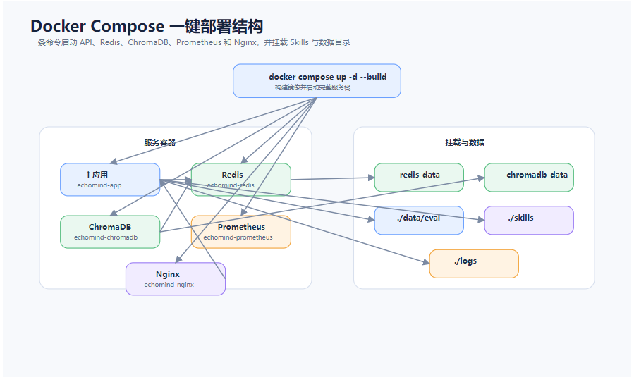

# 布丁智服 · 系统架构与 Docker 服务说明

> 依据：`pudding-java/docker-compose.yml`、`Dockerfile`、`config/nginx/nginx.conf`、`config/prometheus.yml`、`application.yml` 及代码实际实现整理。
> 适用版本：Java 21 + Spring Boot 3.5 + Spring AI 1.1，Compose 共 5 个服务、4 个数据卷。

---

## 1. 一句话架构

**一个 Spring Boot 单体应用 + 四个基础设施容器**：Nginx 做入口，Redis 存短期记忆，Prometheus 做指标采集，ChromaDB 作为向量库。

系统不是微服务，**所有业务逻辑都在 `pudding-java` 一个进程里**（意图识别、路由、检索、记忆、校验、评测）。其余容器只提供「入口、存储、观测」三类能力。



---

## 2. 总体架构图

```text
                        浏览器 / Swagger / curl
                                 │
                 ┌───────────────┴────────────────┐
                 │ :8081                          │ :8080（直连，调试用）
                 ▼                                │
        ┌─────────────────┐                       │
        │  nginx:1.27     │  反向代理 / 限流 / 安全头 / 访问日志
        │  (pudding-java- │  upstream: least_conn
        │   nginx)        │                       │
        └────────┬────────┘                       │
                 │                                │
                 └───────────────┬────────────────┘
                                 ▼
        ┌──────────────────────────────────────────────────┐
        │  pudding-java（Spring Boot 3.5 / Java 21）        │
        │  ┌────────────────────────────────────────────┐  │
        │  │ 记忆读取 → 意图识别 → RAG gating → 检索     │  │
        │  │ → 多 Agent 路由/并行 → 生成 → 校验 → 写回   │  │
        │  └────────────────────────────────────────────┘  │
        │  /health  /docs  /chat  /search  /metrics        │
        └───┬───────────────┬───────────────────┬──────────┘
            │               │                   │
            ▼               ▼                   ▼
   ┌────────────────┐ ┌───────────────┐ ┌──────────────────┐
   │ redis:7        │ │ ChromaDB 0.5  │ │ /app/data 卷      │
   │ 工作记忆+摘要   │ │ 向量库（预留） │ │ knowledge-store  │
   │ :6380→6379     │ │ :8002→8000    │ │ memory-store     │
   └────────────────┘ └───────────────┘ └──────────────────┘
                                              ▲
                                              │ 抓取 /metrics（10s）
                                    ┌─────────┴─────────┐
                                    │ prometheus:2.55   │
                                    │ :9091→9090        │
                                    └───────────────────┘
```

---

## 3. 服务清单

| 服务 | 容器名 | 镜像 | 端口映射（宿主→容器） | 一句话职责 | 数据持久化 |
|---|---|---|---|---|---|
| `pudding-java` | `pudding-java-app` | 本地构建 | `8080:8080` | 全部业务逻辑，HTTP API | `app-data:/app/data` |
| `nginx` | `pudding-java-nginx` | `nginx:1.27-alpine` | `8081:80` | 统一入口、限流、安全响应头 | 无（日志在容器内） |
| `redis` | `pudding-java-redis` | `redis:7-alpine` | `6380:6379` | 会话工作记忆、对话摘要 | `redis-data:/data`（AOF） |
| `chromadb` | `pudding-java-chromadb` | `chromadb/chroma:0.5.23` | `8002:8000` | 向量库，当前为预留位 | `chromadb-data:/chroma/chroma` |
| `prometheus` | `pudding-java-prometheus` | `prom/prometheus:v2.55.1` | `9091:9090` | 指标抓取与存储 | `prometheus-data:/prometheus` |

四个命名卷：`redis-data`、`chromadb-data`、`app-data`、`prometheus-data`。执行 `docker compose down`（不带 `-v`）不会删除它们，容器重建后数据仍在。

---

## 4. 各服务详解

### 4.1 `pudding-java`：唯一的有状态业务进程

**构建**（两阶段，`Dockerfile`）：

```text
maven:3.9.9-eclipse-temurin-21  →  mvn -DskipTests package
eclipse-temurin:21-jre          →  只拷 target/pudding-java-0.1.0.jar
ENTRYPOINT: java $JAVA_OPTS -jar /app/pudding-java.jar
```

**职责**：一次 `/chat` 的全部环节都在这一个进程里完成。

```text
记忆读取 → 意图识别（LLM + n-gram + 关键词）
        → RAG gating（业务意图才检索）
        → 检索（改写 → 4 路并行召回 → BM25+哈希融合 → LLM 重排）
        → 路由（领域分/关键词/实体打分，主辅 Agent 并行）
        → 生成 → 回答校验 → 写回 Redis 与 JSON
        → 指标上报 /actuator/prometheus、/metrics
```

**关键环境变量**（`docker-compose.yml`）：

| 变量 | 值 | 作用 |
|---|---|---|
| `REDIS_HOST` / `REDIS_PORT` | `redis` / `6379` | 容器内走服务名，不是宿主 6380 |
| `CHROMA_HOST` / `CHROMA_PORT` | `http://chromadb` / `8000` | 容器内端口是 8000，**宿主才是 8002** |
| `PUDDING_DATA_DIR` | `/app/data/java` | 知识库与记忆的落盘目录 |
| `KNOWLEDGE_STORE_PATH` | `/app/data/java/knowledge-store.json` | 知识库文件 |
| `MEMORY_STORE_PATH` | `/app/data/java/memory-store.json` | 画像与情节记忆 |
| `LLM_FALLBACK_ENABLED` | `true` | 模型不可用时返回本地兜底话术 |
| `SPRING_PROFILES_ACTIVE` | 默认 `anthropic`，本项目 `.env` 用 `deepseek` | 决定用哪家模型 |

**健康检查**：`curl -sf http://localhost:8080/health`，间隔 30s，`start_period` 90s（给 JVM 启动留余量）。
注意 90s 的启动宽限期意味着：`depends_on` 了它的 Nginx 和 Prometheus 会先启动，不会等应用真正可用。

**依赖**：`redis` 和 `chromadb` 都必须 `service_healthy` 才启动。这也是当前启动链路的隐性成本——即使 Chroma 不参与检索，它不健康时应用也不会起。

### 4.2 `redis`：短期记忆与会话摘要

- 镜像 `redis:7-alpine`，启动参数 `--appendonly yes`（AOF 持久化），强制密码 `${REDIS_PASSWORD:-pudding123}`。
- 存两类 key：
  - `wm:{userId}:{conversationId}`：List，最近消息（默认最多 20 条），TTL 86400s；
  - `summary:{userId}:{conversationId}`：String，压缩后的对话摘要，TTL 同样一天。
- 消息数到 15 触发压缩，总结成 2–3 句后只保留最近 5 条。
- **故障影响**：Redis 不可用时应用启动会失败（健康检查不通过）；运行中不可用会导致上下文为空、摘要读不到，但不会让整个请求崩，回答质量下降。
- 端口 `6380:6379` 是刻意错开宿主默认 6379，避免和你已有的 Redis 冲突。

### 4.3 `chromadb`：向量库预留位（当前不参与检索）

- 镜像 `chromadb/chroma:0.5.23`，`IS_PERSISTENT=TRUE`，数据落在 `/chroma/chroma`，宿主端口 8002。
- **Java 版两个 profile 都排除了 `ChromaVectorStoreAutoConfiguration`**，`VectorStore` 注入为 `null`，写入是空操作，检索走本地 BM25 + 256 维特征哈希。
- 之所以保留：技术栈演示、与 Python 版对照（Python 版才是真接 Chroma + all-MiniLM-L6-v2）。
- **面试口径**：不要说「用 Chroma 做向量检索」，要说「Chroma 是预留位，Java 侧未启用，主召回是本地混合检索」。
- **代价**：它被写进 `depends_on` 的健康条件，属于「启动了但没用上」的依赖，会拖慢首次启动、增加一个故障点。

### 4.4 `prometheus`：指标采集

- 镜像 `prom/prometheus:v2.55.1`，宿主 9091 → 容器 9090。
- 抓取配置（`config/prometheus.yml`）：
  - job `pudding-java-app`：`metrics_path: /metrics`，`scrape_interval: 10s`，目标 `pudding-java:8080`；
  - job `prometheus`：抓自己。
- 应用侧指标由 Micrometer 注册：Agent 成功率（Gauge）、监控采集次数（Counter）、采集耗时（Timer），另有 JVM / HTTP 默认指标。
- **边界**：只有采集和存储，**没有告警规则文件**；应用内的 `/monitor` 会算 penalty 并支持 webhook，但告警不闭环（`resolved` 恒 false）。

### 4.5 `nginx`：统一入口

- 镜像 `nginx:1.27-alpine`，宿主 8081 → 容器 80，配置文件以只读方式挂载。
- 承担的职责：
  - **反向代理**：`upstream pudding_java_backend` 用 `least_conn` + `keepalive 32`；
  - **限流**：`limit_req 10r/s burst=20 nodelay` + `limit_conn 10`；
  - **请求体上限**：`client_max_body_size 10M`（对应知识库上传限制）；
  - **压缩**：gzip（注意：如果将来上 SSE，需要关掉 `proxy_buffering` 并谨慎处理 gzip）；
  - **安全响应头**：`X-Frame-Options`、`X-Content-Type-Options`、`X-XSS-Protection`、`Referrer-Policy`；
  - **访问日志**：`/var/log/nginx/access.log`。
- 路由规则：

| location | 行为 |
|---|---|
| `/` | 代理到应用，带限流与连接数限制 |
| `/health` | 单独代理，`access_log off`；**必须显式设置 `Host $host`** |
| `/metrics` | 只允许 `127.0.0.1` 与 `172.16.0.0/12`（Docker 网段），其余 403 |

> 补充：Prometheus 实际抓的是 `pudding-java:8080/metrics`（直连容器网络），并不经过 Nginx。所以 Nginx 上这条 `/metrics` 白名单目前用不到，属于「以后要从外部网关暴露指标」的预留规则。

> ⚠️ 已修复的一个真实 bug：`/health` 原来没设 `Host`，Nginx 会把 upstream 名 `pudding_java_backend`（含下划线）当 Host 发给 Tomcat，Tomcat 10 判定域名非法直接返回 400。修复方式是在该 location 补 `proxy_http_version 1.1` 和 `proxy_set_header Host $host`。

### 4.6 数据卷

| 卷 | 挂载点 | 内容 | 丢失后果 |
|---|---|---|---|
| `app-data` | `/app/data` | `knowledge-store.json`（6 个知识片段）、`memory-store.json`（画像/情节记忆）、`data/eval/baseline.json` | 知识库回到默认 6 篇，画像与评测基线丢失 |
| `redis-data` | `/data` | AOF 文件 | 会话上下文与摘要丢失 |
| `chromadb-data` | `/chroma/chroma` | Chroma 持久化目录 | 当前无实际影响（未使用） |
| `prometheus-data` | `/prometheus` | TSDB 时序数据 | 历史指标丢失 |

---

## 5. 一次 `/chat` 请求经过哪些容器

```text
客户端
  └─ :8081  Nginx ── 限流/安全头/日志
        └─ :8080  pudding-java
              ├─ Redis        读取工作记忆、摘要（LRANGE / GET）
              ├─ 应用本地      意图识别 → gating → 检索（BM25 + 哈希）→ 路由 → 生成
              ├─ 外部          调用 LLM（DeepSeek / Anthropic）
              ├─ 应用本地      回答校验（AnswerVerifier）
              └─ Redis        写回消息、更新摘要；画像落 JSON
                    └─ Prometheus 周期性抓取 /metrics（与请求异步）
```

只有 Redis 和外部模型调用会离开应用容器；**检索、校验、评测都在进程内完成**，所以一次请求的容器间往返很少，延迟主要来自 LLM 串行调用（普通 3 次，走 RAG 最多 5 次）。

---

## 6. 端口与网络

| 宿主端口 | 容器端口 | 服务 | 说明 |
|---:|---:|---|---|
| 8080 | 8080 | pudding-java | 直连端口，调试/问题定位用 |
| 8081 | 80 | nginx | 对外统一入口，建议只用这个 |
| 6380 | 6379 | redis | 错开默认 6379，避免冲突 |
| 8002 | 8000 | chromadb | **宿主 8002、容器 8000**，配错会连不上 |
| 9091 | 9090 | prometheus | 错开默认 9090 |

所有服务都在 Compose 默认网络 `pudding-java_default` 内，通过服务名互相访问（`redis`、`chromadb`、`pudding-java`）。容器内的 `REDIS_PORT=6379`、`CHROMA_PORT=8000` 是容器端口，不要写成宿主端口。

---

## 7. 启动与验证

```bash
# 启动（首次或代码变更后）
docker compose up -d --build

# 仅重启
docker compose up -d

# 查看状态与日志
docker compose ps
docker compose logs -f pudding-java
```

验证清单：

```bash
curl http://localhost:8080/health            # 应用自身
curl http://localhost:8081/health            # 经 Nginx
curl http://localhost:8080/docs              # Swagger UI
curl http://localhost:9091/-/healthy         # Prometheus 自身
curl "http://localhost:9091/api/v1/targets"  # 抓取目标是否为 up

curl -X POST http://localhost:8081/chat \
  -H "Content-Type: application/json" \
  -d '{"message":"你好","user_id":"u1001"}'
```

一次成功请求的返回里应能看到：`intent`、`agent_type`、`verified`、`grounded`、`latency_ms`。若 `verified=false` 或 `escalated=true`，说明回答校验没通过或触发了人工升级。

**前端不在本 Compose 内**：`pudding-frontend` 是独立的 Vue + Vite 项目，需单独启动（`pnpm dev`，默认 5173），通过 Vite 代理 `/api/java` 连到 8080。

---

## 8. 设计取舍与已知边界

| 取舍 | 现状 | 影响 |
|---|---|---|
| 单体 vs 微服务 | 全部业务在一个 JVM 里 | 部署简单、调用无网络开销；但无法按模块独立扩容 |
| Chroma 预留 | 容器启动但不参与检索 | 技术栈有「名不副实」风险，需主动说明 |
| 应用单实例 | 每类 Agent 只有 1 个实例 | 监控降权只能告警，无法真正分流 |
| 无鉴权 | API 无 Token/Key 校验 | 只能内网或加网关；上线前必须补 |
| 限流在 Nginx | 应用层无限流 | 绕过 Nginx 直连 8080 就没有保护 |
| 无日志收集 | 日志只在容器 stdout | 排障靠 `docker compose logs`，无集中检索 |
| 健康检查启动宽限 90s | 依赖方先起 | 编排层看到「启动」不等于「就绪」 |
| 评测 baseline 在卷里 | `data/eval/baseline.json` | 容器重建不丢，但没有版本管理 |

---

## 9. 当前运行状态（记录）

最近一次验证：`8081/health` 返回 200、`8081/docs` 200、`POST /chat` 返回 200（`intent=greeting`、`agent=general`、`latency_ms=669`）。

随后容器整体退出（`docker ps -a` 显示 5 个容器均 `Exited`，应用为 `Exited (137)`，通常是 Docker Desktop 退出或强制终止导致）。数据卷仍在，重新拉起即可，无需重建镜像：

```bash
cd 布丁智服/pudding-java
docker compose up -d
```

---

## 10. 一句话总结

**Nginx 管入口与防护，Redis 管短期记忆，应用进程管全部智能逻辑，Prometheus 管观测，ChromaDB 管「未来的语义检索」——当前真正跑业务的是前三者。**