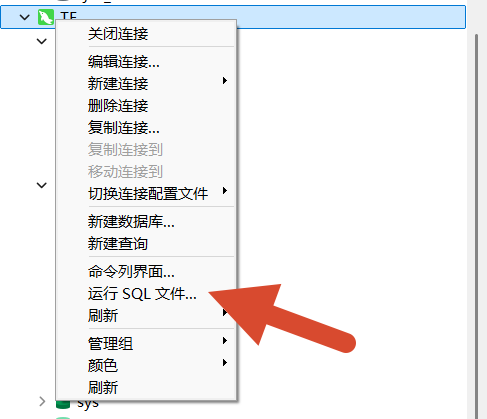
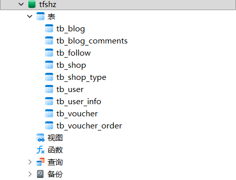

### 数据库

文件位置


注意MySql需要5.7及以上的版本，否则会报错，命令行连接MySQL命令如下

> 另外 数据库端口为3306,而不是3360,别连接错了

```bash
mysql -u root -p -P 3306
```

一般采用Navicat连接


运行前面提到的`tfshz.sql`即可



使用Navicat连接后如下


其中涉及的数据库表如下：


