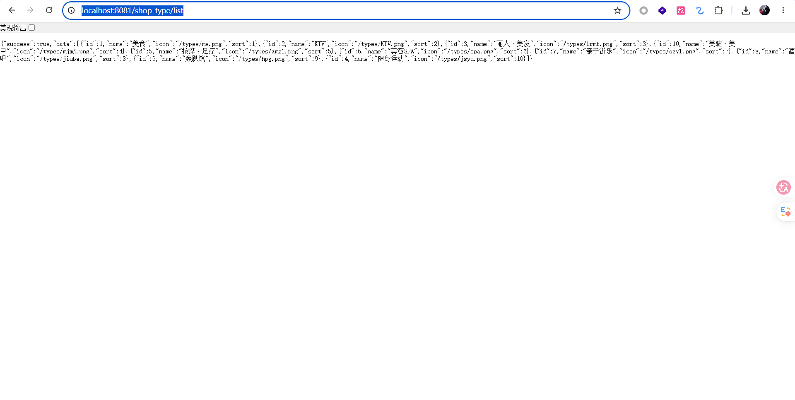
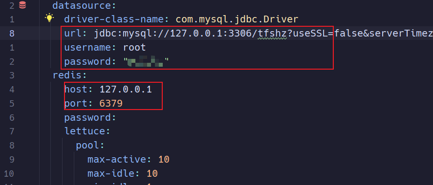
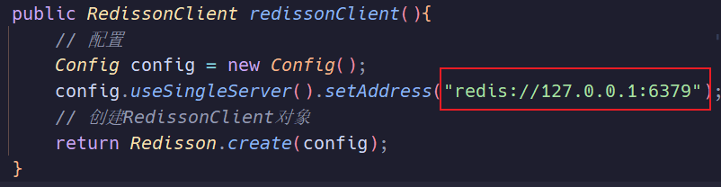
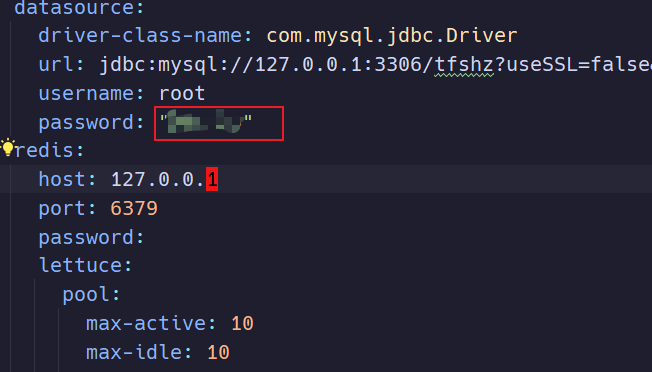

### 成功标志

访问http://localhost:8081/shop-type/list

### 问题0：修改配置文件中MySQL和Redis中的配置信息

`\src\main\resources\application.yaml`中修改

`src/main/java/com/hmdp/config/RedissonConfig.java`中修改

  ### 问题 1：所有访问数据库的接口报 Access denied for user 'root'@'localhost'

  application.yaml 里 password: 六位数字 没加引号，SnakeYAML 把它当八进制解析成了
  另一个数字（我实测验证过），应用实际用错误密码连接，登录等接口全部返回"服务器异常"。

  修复：password: "六位数字"（加引号）。

  ### 问题 2：启动后无限刷 NOGROUP ... 处理订单异常（最显眼的报错）

  VoucherOrderServiceImpl 的 VoucherOrderHandler 在 XREADGROUP 前从未创建消费者组，Redis 里没有 stream.orders 的 g1 组 →
  异常被 catch 后进入 handlePendingList() 死循环重试，日志里刷了几万条错误。

  修复（VoucherOrderServiceImpl.java:63）：启动时先创建消费者组，已存在则忽略 BUSYGROUP：
  @PostConstruct
  private void init() {
      // 创建消费者组（Redis 中没有 stream.orders 的 g1 组时，XREADGROUP 会报 NOGROUP 错误）
      try {
          stringRedisTemplate.opsForStream().createGroup("stream.orders", "g1");
      } catch (Exception e) {
          // 消费者组已存在时 Redis 返回 BUSYGROUP 错误，忽略即可
      }
      SECKILL_ORDER_EXECUTOR.submit(new VoucherOrderHandler());
  }
  顺手修了同段代码的另一个 bug：XACK 用的 stream key 是 "s1"，应为 "stream.orders"（否则已处理消息永远留在 PEL 里）。

好，把问题 1 掰开揉碎讲一遍。我们先把它翻译成一句人话，再从最根本的地方推导。

  先用人话复述这个 bug

  应用启动时有一个后台线程，它要"订阅"Redis 里一条叫 stream.orders
  的消息队列。但它订阅时用了一个还没注册的"读者小组"（消费者组 g1）。Redis
  直接拒绝："NOGROUP——你让我用的小组根本不存在"。代码把异常抓起来后，又跳进另一个同样依赖这个小组的循环里再试，又报同样
  的错，又抓，又试……没有出口，于是几万条错误刷屏。

  要真正理解为什么，得回答三个"为什么"：为什么要有队列？什么是消费者组？Redis 为什么不自动创建？

  第一性原理推导

  1. 为什么要有这条队列？

  秒杀的场景：一瞬间几万人同时下单。如果每个请求都同步去数据库做三件事（查重、扣库存、插订单），数据库就是瓶颈——几千个线
  程同时卡在数据库上，系统直接瘫痪。

  所以设计成两条路：

  海量请求 ──→ Redis Lua 脚本（快路径）     ← 只做"资格校验"：库存够吗？重复下单吗？
                  │ 通过后：扣 Redis 库存、记用户、把订单信息 XADD 进 stream
                  ▼
           stream.orders（排队区）
                  │
    一个后台线程（慢路径）── 逐条取出 → 写数据库（查重/扣MySQL库存/建订单）

  控制器拿到 Lua 的结果后立刻返回订单号，用户不用等数据库。数据库的活儿交给后台线程慢慢干。这叫"削峰"——前台只管发牌，后
  厨一张一张做菜。队列存在的根本原因：把"快"和"慢"拆开，快的那边不能被慢的那边拖死。

  2. Redis Stream 是什么？为什么还需要"消费者组"？

  Redis Stream 本质是一本只追加、不修改的台账：每条消息 XADD
  进去就有一个唯一递增的编号（时间戳-序号），消息被读走后并不会消失——就像公告栏上的通知，你看了不等于它被撕下来。

  问题来了：后台线程每次 XREAD 时，怎么知道"上次读到哪里了"？两种做法：

  - 自己记页码：线程自己存一个"读到哪了"的游标。简单，但没人帮你记，也没人兜底。
  - 消费者组：让 Redis 帮我们记账。这是 Redis Stream 的精妙之处——组里有三个关键机制：
    - 投递游标：组里登记每个消费者"下一次该读哪条"。
    - > 特殊 ID：XREADGROUP 里传 >，意思是"只给我从没投递过的消息"。有了组，多条消息才会依次派发、不会重复派发。
    - PEL（待确认清单）：消息派发给你后，先记在 PEL 里，等你 XACK
    确认"我处理完了"才销账。如果消费者处理到一半崩了，消息还留在 PEL 里，可以重新投递——这就是"至少一次"投递的兜底。

  消费者组解决的根本问题：在"消息不自动消失"的台账模型下，可靠地记录"谁负责哪条、处理完了没有"。单机只有一个消费者时这些
  好处不明显，但它本来就是为"多个工人协作 + 故障兜底"设计的。

  3. 为什么 Redis 不自动创建？—— NOGROUP 的本质

  这是最关键的第一性原理。XGROUP CREATE stream g1 0 和 XGROUP CREATE stream g1 $ 都是合法的建组命令，但含义完全不同：

  - 0：从头开始——建组之前已存在的旧消息，我也要读。
  - $：从现在开始——旧消息不归我管，只收新建组之后的新消息。

  Redis 无法替你做这个决定：如果 XREADGROUP 遇到不存在的组就自动创建，它该从 0 还是 $
  开始？猜错就可能是漏读旧消息或重复处理。所以 Redis 的选择是：拒绝并报错，把决定权留给你。NOGROUP 不是 bug，是 Redis
  在说："这个组需要显式创建，请告诉我起点"。

  （课上的做法正是手工执行一次 XGROUP CREATE stream.orders g1 0 MKSTREAM——你的 Redis
  重启过或被清过，这条命令的成果丢了，于是报错。）

  4. 为什么是"刷屏"而不是"报一次错"？

  跟着代码走一遍：

  1. 主循环 XREADGROUP → NOGROUP（错误是立即返回的，那个 block(2s) 只在"没消息时等 2 秒"才生效，报错时根本不阻塞）→
    抛异常。
  2. catch 里调用 handlePendingList() → 它内部 XREADGROUP 用的还是同一个不存在的组 → 又抛异常 → 它的 catch 再 log → 内层
    while(true) 继续。
  3. 于是变成无等待的空转死循环，每秒能打几千条"处理订单异常"。日志被淹没，Redis 也被无效命令轰炸。

  根本缺陷不是"没捕获异常"，而是"前置条件缺失"：组不存在时，主循环和兜底循环全都无从谈起——就像售票窗口和排队规则还没建立
  ，检票员就开始检票。

  5. 修复的第一性原理：把"组存在"变成启动时的前置条件

  修复只做一件事：在启动线程之前，保证组存在。

  try {
      stringRedisTemplate.opsForStream().createGroup("stream.orders", "g1");
  } catch (Exception e) {
      // BUSYGROUP：组已存在 → 目标状态已满足 → 忽略
  }

  这和 CREATE TABLE IF NOT EXISTS
  是同一个思想：幂等。你要的是"组存在"这个状态，而不是"执行创建"这个动作。第一次启动它创建（MKSTREAM 顺带把不存在的
  stream 也建了）；第二次启动它发现已存在，跳过。BUSYGROUP 异常不是错误，是"状态已达标"的信号——所以静默忽略是对的。

  6. 顺带说 XACK 那个 bug，因为它很阴险

  XACK 确认的 key 写成了 "s1"，而消息实际在 stream.orders 里。XACK 一个不存在的 key 不会报错，只会返回
  0——所以它静默失败，每条处理成功的消息都赖在 PEL 里销不掉。这也是为什么它比 NOGROUP 更隐蔽：报错的 bug 会喊，不报错的
  bug 会埋雷。

---
  考考你（请用自己的话回答，不用背）

  1. 消息被消费后不会从 Stream 消失，那消费者组靠什么保证同一条消息不会被这个组的消费者重复处理？
  2. 为什么 Redis 不肯在 XREADGROUP 遇到不存在的组时自动创建？（提示：想想建组命令里的参数）
  3. 建组时用 $ 和用 0 的区别是什么？如果消息在组创建之前就已经进 stream 了，用 $ 会发生什么？
  4. 这个 bug 为什么是无限刷屏而不是报一次就停？哪个细节让循环连 2 秒的喘息都没有？
  5. 假设消息处理成功、但还没来得及 XACK 进程就崩溃了，重启后这条消息会丢吗？我们代码里的哪个机制把它捞回来？

  不用急，答错说明我的讲解有问题，我会换个角度再讲。答完我告诉你每题对不对。

